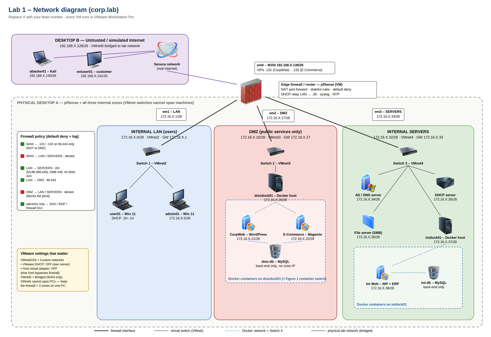

# SPR500 — Security Policies and Network Security (Group 6)

Group project work for SPR500 at Seneca Polytechnic (Fall 2026): designing, building, segmenting and assessing a virtual enterprise network (`group6.local`) in VMware.

| Stage | Contents |
|---|---|
| [Lab 01 — Enterprise network design and implementation](lab01/final-report.md) | Flat network behind an nftables edge router, AD DS, DHCP/DNS, Joomla/PrestaShop/Odoo/Samba services, test cases, deployment evidence. Includes a [TVRA (threat and vulnerability risk assessment)](lab01/tvra-report.md) |
| [Lab 02 — Security zones](lab02/final-report.md) | Migration to a zoned design: 802.1Q VLANs on Open vSwitch, OSPF with MD5 authentication (FRR), default-deny stateless nftables, split private/public DNS, DMZ isolation, vulnerability scans. See also the [migration plan](lab02/migration-plan.md) |
| [Project — Stage 1](project/stage1-conceptualization.md) | Passive OSINT technical specification of a public company (no traffic sent to the target) |

**Skills:** network design · VLANs and segmentation · nftables firewalls · OSPF · Active Directory · DNS/DHCP · risk assessment (TVRA) · OSINT
