# SPR500 Lab 01 — Enterprise Network Design and Implementation

|                           |                                               |
|---------------------------|-----------------------------------------------|
| Domain                    | group6.local                                  |
| Team                      | Group 6                                       |
| Allocated address space   | 192.168.6.128/28                              |
| Internal segment deployed | 192.168.6.128/28                              |
| Transit link              | 192.168.6.144/30                              |
| External segment          | 10.10.10.0/28                                 |
| Environment               | VMware Workstation Pro — Seneca Security Lab  |
| Course / section          | SPR500 — NBB                                  |
| Professor                 | Enayet Hussain                                |
| Submission date           | 2026-09-23                                    |

*Initial Deployment — Final Report*

# Contents

[1. Executive summary](#executive-summary)

[2. Business requirements and test cases](#business-requirements-and-test-cases)

[3. Network design](#network-design)

[3.1 Topology](#topology)

[3.2 IP addressing schema](#ip-addressing-schema)

[4. Network devices](#network-devices)

[5. Deployment evidence](#deployment-evidence)

[5.1 Perimeter and edge router](#perimeter-and-edge-router)

[5.2 Internal router](#internal-router)

[5.3 External segment](#external-segment)

[5.4 Name resolution and directory services](#name-resolution-and-directory-services)

[5.5 Identity and privileged access](#identity-and-privileged-access)

[5.6 Address assignment](#address-assignment)

[5.7 File sharing](#file-sharing)

[5.8 Business services](#business-services)

[6. Logbook](#logbook)

[7. Conclusion](#conclusion)

# 

# 1. Executive summary

This report presents the first time deployment of Group 6's infrastructure within the Seneca Security Lab environment. Four critical enterprise services have been provisioned: corporate website, ecommerce website, intranet collaboration/ERP system, and internal file sharing system. The supporting enterprise infrastructure consists of centrally managed identity management and name resolution service, automatic IP address assignment, and two layers of routing boundary with network address translation and packet filtering.

A flat network design has been adopted for the internal network which consists of a single IP network 192.168.6.128/28, created out of the assigned range of 192.168.6.128/2**8**. There is a transit network 192.168.6.144/30 between the edge router and internal router. All the enterprise services are accessible to the authorized users, the public websites are accessible from the untrusted network, and the intranet collaboration system is inaccessible from outside the perimeter.

# 2. Business requirements and test cases

| **Req_ID** | **Requirement description** | **Test case description** | **Acceptance criteria** | **Evidence** |
|----|----|----|----|----|
| BR-01 | Public corporate website reachable by external users | Browse corpweb.group6.local from the external user host | Site loads successfully | Figure 20 |
| BR-02 | Public e-commerce website reachable by external users | Browse esite.group6.local from the external user host | Storefront loads successfully | Figure 21 |
| BR-03 | Internal collaboration system available internally only | Browse intcorp.group6.local from internal and external hosts | Loads internally, refused externally | Figures 22, 23 |
| BR-04 | Internal file sharing available to authorised users | smbclient -L //192.168.6.134 -U jsmith | Authorised user connects, shares listed | Figure 17 |
| BR-05 | Legacy SMB protocols refused | Observe protocol negotiation on connect | SMB1 reported as disabled | Figure 17 |
| BR-06 | Centralised forward and reverse name resolution | Query A, PTR and CNAME records on the domain controller | All records resolve correctly | Figures 9, 10 |
| BR-07 | Automatic address assignment for client hosts | Client requests a lease from the DHCP server | Lease issued with correct gateway and DNS | Figures 13, 14 |
| BR-08 | Centralised identity with privileged administration | Create domain account and verify group membership | Account enabled and in Domain Admins | Figures 11, 12 |
| BR-09 | Internal hosts reach the internet through the perimeter | Connectivity test from an internal host outward | Traffic succeeds via NAT on the edge router | Figures 6, 7 |
| BR-10 | Routing between all segments functions correctly | Reachability tests across transit and internal segments | All segments reachable in both directions | Figures 4, 5 |

# 3. Network design

## 3.1 Topology

The deployment uses a two-tier routing model. The edge router provides the perimeter between the untrusted external segment and the organisation, performing network address translation and packet filtering. The internal router acts as the default gateway for the internal segment. All business services reside on a single flat internal segment, so traffic between services is switched rather than routed and the internal router functions as the gateway and filtering point rather than as an inter-service router.

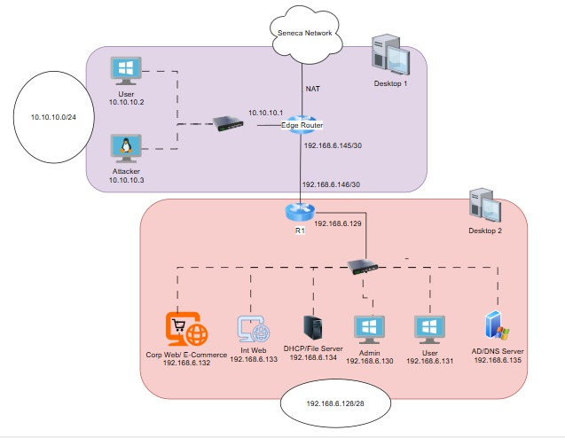

*Figure 1 — Network design diagram showing the external segment, perimeter, transit link and flat internal segment*

## 3.2 IP addressing schema

|  |  |
|----|----|
| Allocated range | 192.168.6.128/28 (192.168.6.128 – 192.168.6.141) |
| Internal segment | 192.168.6.128/28 — mask 255.255.255.240 |
| Usable internal addresses | 192.168.6.129 – 192.168.6.142 |
| Transit link | 192.168.6.144/30 — .145 edge, .146 internal router |
| Static infrastructure | 192.168.6.129, dhcp – 192.168.6.134 |
| DHCP dynamic pool | 192.168.6.130 – 192.168.6.140 |
| External segment | 10.10.10.0/28 — gateway 10.10.10.1 |

The internal segment was deployed as a /28. This leaves the remainder of the allocation available for future segmentation while providing sufficient addresses for the current service count. Static infrastructure addresses and DHCP reservations are placed outside the dynamic pool to prevent address conflicts.

# 4. Network devices

| **FQDN** | **Role** | **Interface** | **IP Address (CIDR)** | **Gateway** |
|----|----|----|----|----|
| edge.group6.local | Perimeter router, NAT | ens33 (WAN) | 192.168.166.128/24 (DHCP) | 192.168.166.2 |
| edge.group6.local | Perimeter router | ens36 (external) | 10.10.10.1/28 | — |
| edge.group6.local | Perimeter router | ens37 (transit) | 192.168.6.145/30 | — |
| r1.group6.local | Internal router, gateway | ens33 (transit) | 192.168.6.146/30 | 192.168.6.145 |
| r1.group6.local | Internal router, gateway | ens35 (LAN) | 192.168.6.129/28 | — |
| corpweb.group6.local | Container host — corporate and e-commerce sites | ens33 | 192.168.6.131/28 | 192.168.6.129 |
| intcorp.group6.local | Internal collaboration and ERP | ens33 | 192.168.6.132/28 | 192.168.6.129 |
| fileserver.group6.local | File sharing and DHCP | ens33 | 192.168.6.134/28 | 192.168.6.129 |
| dc.group6.local | Domain controller, DNS | Ethernet0 | 192.168.6.135/28 | 192.168.6.129 |
| \[external user\] | Untrusted external client | Ethernet0 | 10.10.10.0/28 range | 10.10.10.1 |
| \[attacker\] | Untrusted external host (Kali) | eth0 | 10.10.10.0/28 range | 10.10.10.1 |

# 5. Deployment evidence

## 5.1 Perimeter and edge router

The edge router carries three interfaces: an uplink to the lab network providing internet access, the untrusted external segment hosting the simulated external user and attacker, and the transit link to the internal router. The routing table contains a static route returning traffic for the internal segment via 192.168.6.146.

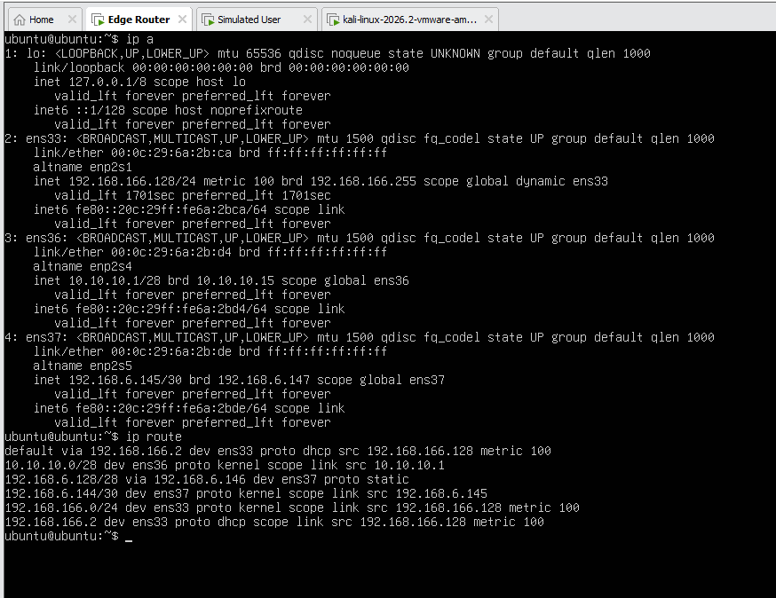

*Figure 2 — Edge router interface addressing and routing table*

Network address translation is applied on the uplink interface so that internal and external segment traffic is masqueraded on egress. The ruleset is persisted in /etc/nftables.conf.

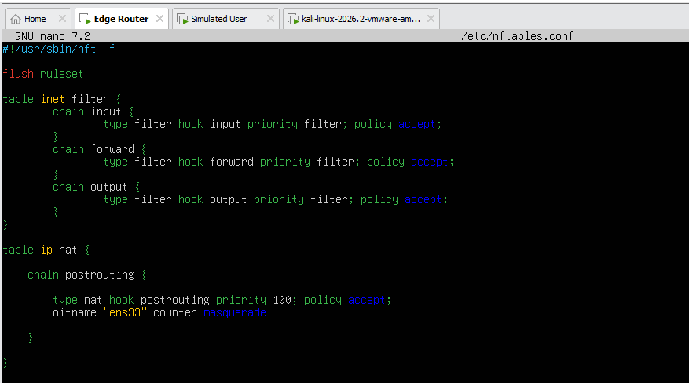

*Figure 3 — Edge router nftables ruleset showing NAT masquerade on the uplink interface*

Reachability from the edge router confirms that the transit link, the internal gateway, and the internal service hosts are all routable across the perimeter.

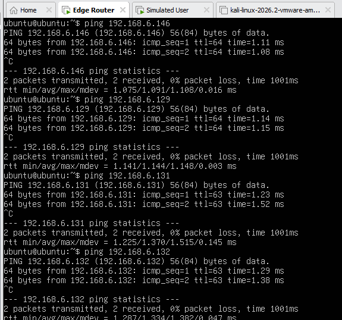

*Figure 4 — Edge router reachability to the internal router, gateway and service hosts*

## 5.2 Internal router

The internal router holds the transit address on ens33 and the internal gateway address on ens35. The default route points to the edge router and IP forwarding is enabled, allowing the router to forward traffic between the internal segment and the perimeter.

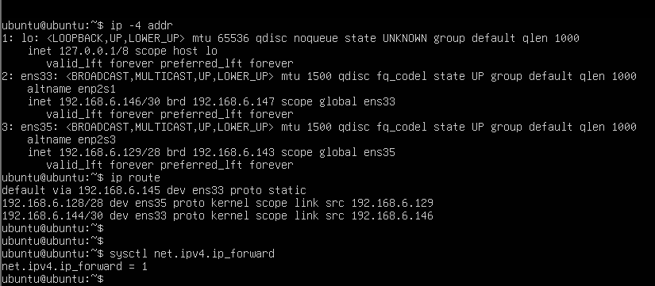

*Figure 5 — Internal router interface addressing, routing table and IP forwarding status*

Reachability tests from the internal router confirm connectivity to the edge router and to the service hosts on the internal segment.

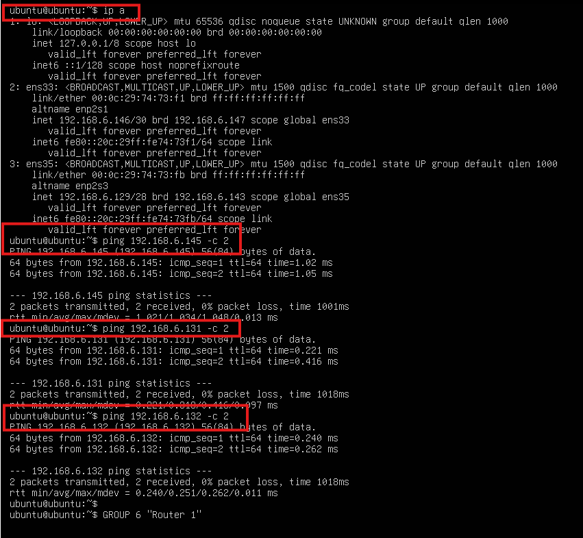

*Figure 6 — Internal router reachability to the edge router and internal service hosts*

## 5.3 External segment

The simulated external user reaches the internet through the edge router, confirming that NAT is correctly applied to the untrusted segment.

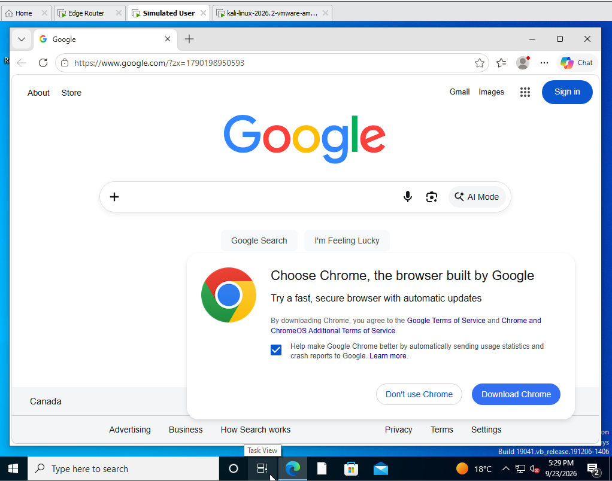

*Figure 7 — External client internet connectivity through the edge router*

The attacker host on the external segment reaches its gateway and the external user host, confirming the external segment is functional and correctly isolated from the internal segment.

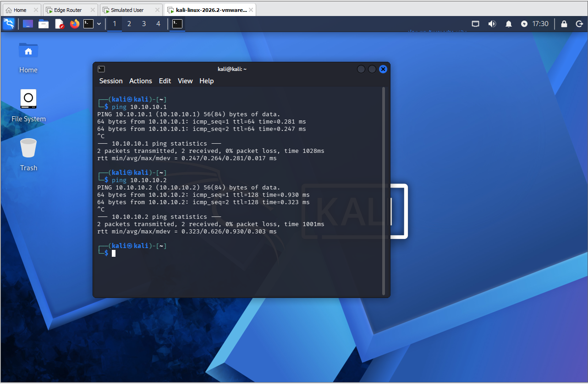

*Figure 8 — Attacker host reachability within the external segment*

## 5.4 Name resolution and directory services

The domain controller hosts the group6.local forward lookup zone and the 6.168.192.in-addr.arpa reverse lookup zone. Forward A records exist for all infrastructure hosts, PTR records provide reverse resolution, and CNAME aliases map the e-commerce and DHCP service names to their host records.

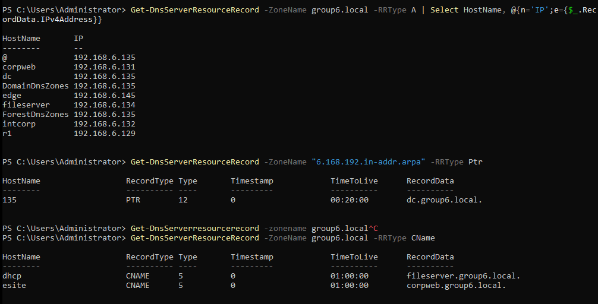

*Figure 9 — Forward A records, reverse PTR records and CNAME aliases in the group6.local zone*

Internal hosts are configured to use the domain controller as their sole DNS server, with group6.local as the search domain.

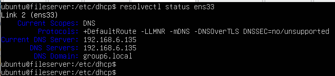

*Figure 10 — Client DNS configuration pointing to the domain controller*

## 5.5 Identity and privileged access

A named administrative account, SPR500Admin, was created in the Staff organisational unit and added to Domain Admins. A named account is used in preference to the built-in Administrator account so that privileged actions are attributable in the security log.

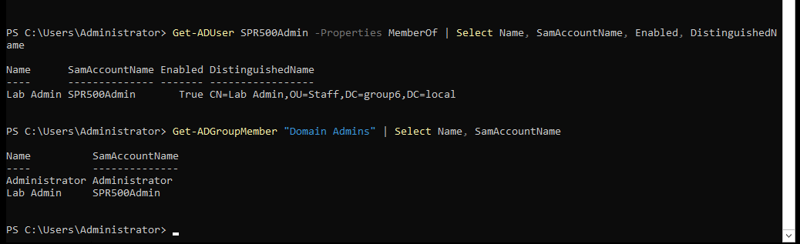

*Figure 11 — Domain administrative account and Domain Admins group membership*

A standard domain user account was created and used to log in to the administration workstation, confirming that domain authentication functions across the network.

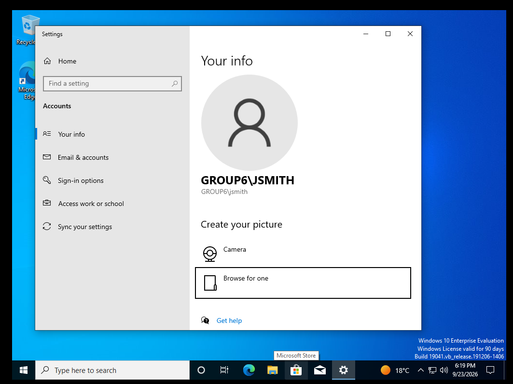

*Figure 12 — Domain user authenticated on the administration workstation*

## 5.6 Address assignment

The DHCP service is configured with a scope matching the internal segment. Static reservations bind service hosts to fixed addresses by MAC address, and the dynamic pool serves remaining client hosts. Gateway, DNS server and domain name options are distributed with each lease.

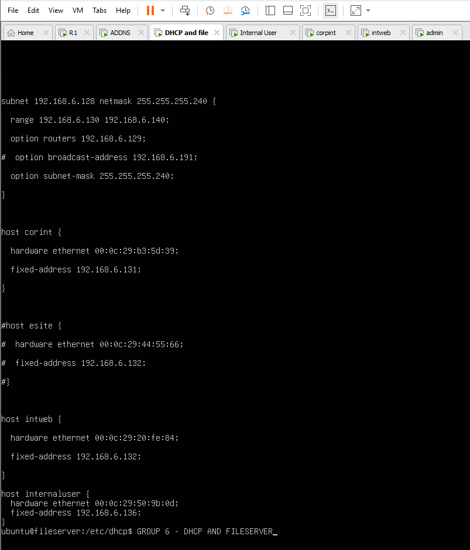

*Figure 13 — DHCP scope configuration and static host reservations*

The lease database confirms that addresses are being issued to requesting clients on the internal segment.

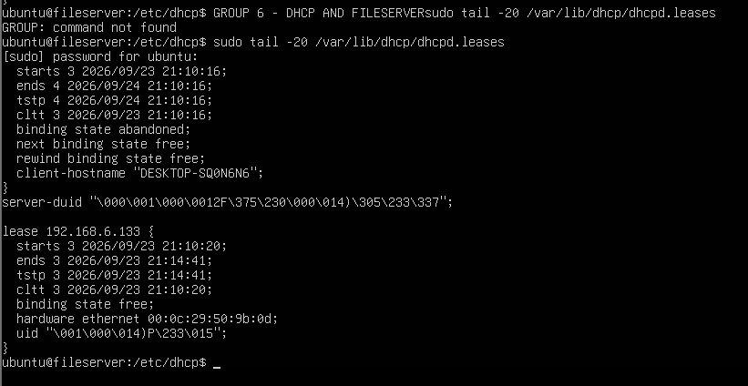

*Figure 14 — DHCP lease database showing an issued client lease*

## 5.7 File sharing

The Samba service runs on the file server and is enabled at boot.

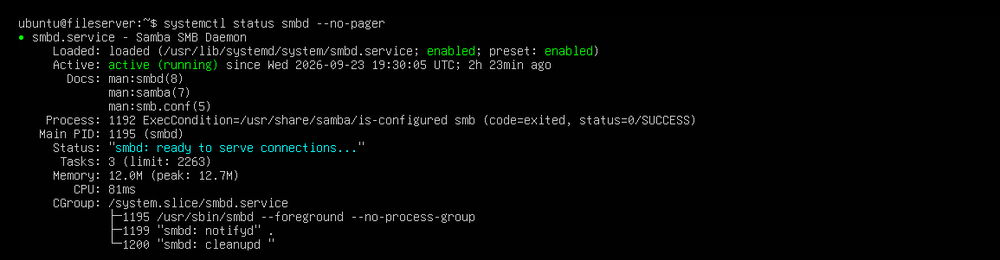

*Figure 15 — Samba service running on the file server*

The effective configuration enforces SMB3 as the minimum protocol on both server and client, mandatory signing, restricted anonymous access, and source address restriction to the internal segment. Two shares are defined: a general staff share and a restricted HR share that is not browseable.

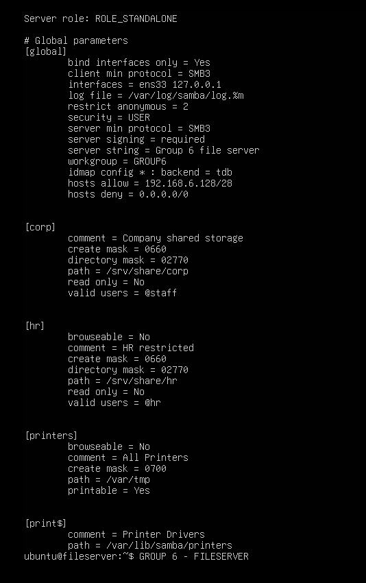

*Figure 16 — Effective Samba configuration and share definitions*

An authorised domain-named account successfully authenticates and enumerates the available shares. The server reports SMB1 as disabled, confirming that legacy protocol support has been removed.

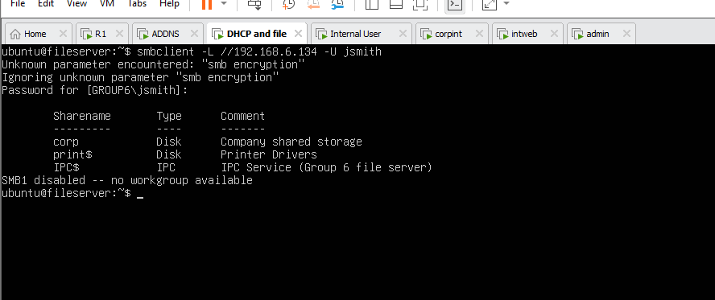

*Figure 17 — Authorised SMB authentication with SMB1 confirmed disabled*

## 5.8 Business services

The corporate and e-commerce websites run as containers on a single host behind an nginx reverse proxy, which routes requests to the correct application by host header. All containers report a healthy running state.

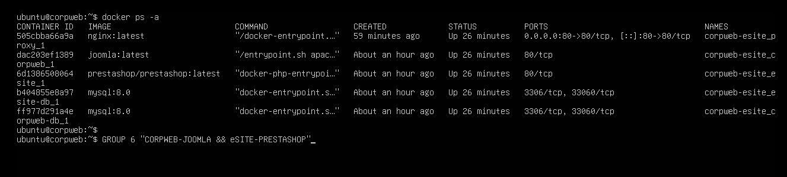

*Figure 18 — Container stack hosting the corporate and e-commerce websites*

The internal collaboration and ERP system runs as a separate container stack with its own database backend.

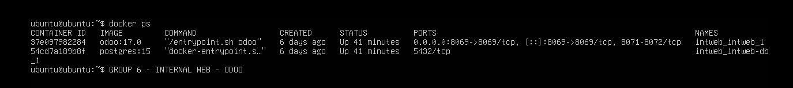

*Figure 19 — Container stack hosting the internal collaboration and ERP system*

The external user successfully reaches the public corporate website by fully qualified domain name.

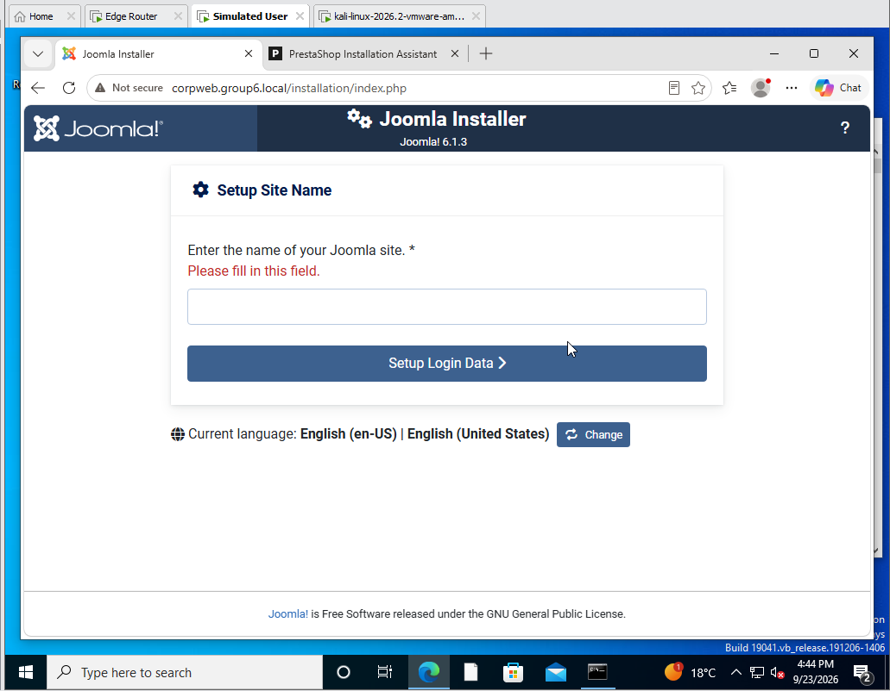

*Figure 20 — External user accessing the corporate website at corpweb.group6.local*

The external user successfully reaches the public e-commerce website, resolved through the CNAME alias to the same container host.

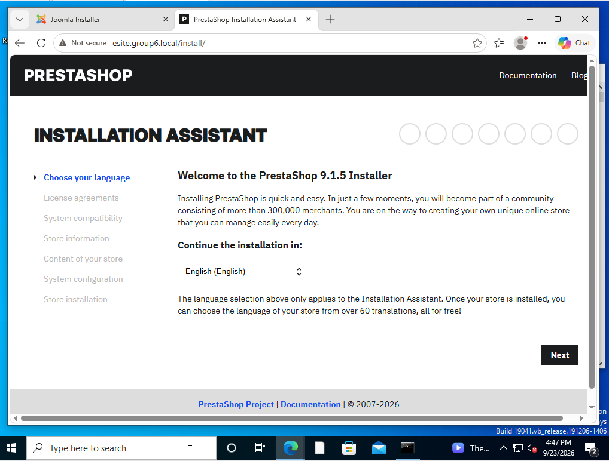

*Figure 21 — External user accessing the e-commerce website at esite.group6.local*

An internal user successfully reaches the internal collaboration system.

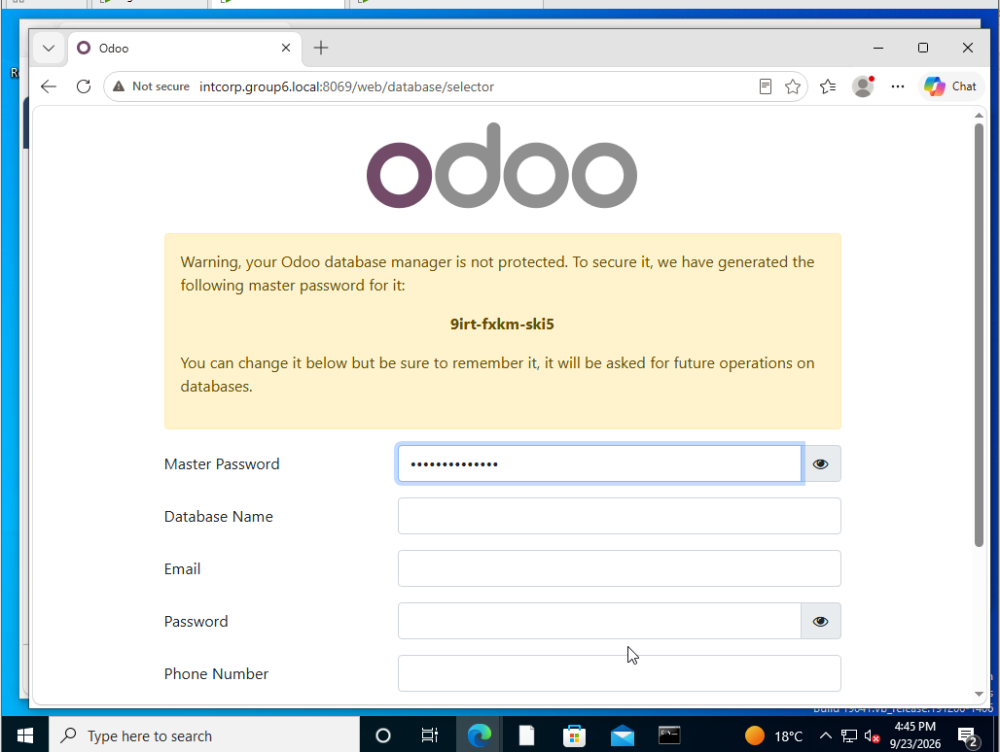

*Figure 22 — Internal user accessing the collaboration and ERP system at intcorp.group6.local*

The same internal collaboration system is not reachable from the external segment. The connection times out at the perimeter, confirming that the internal service is not exposed to untrusted hosts. This is the primary demonstration that the perimeter boundary is enforced.

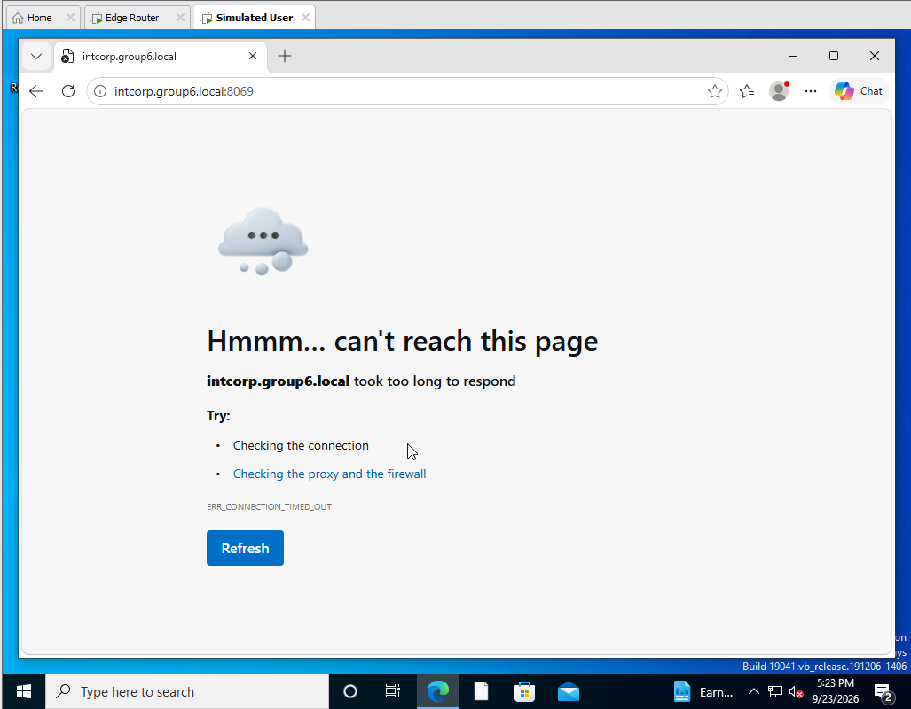

*Figure 23 — External user denied access to the internal collaboration system*

# 6. Logbook

| **From (date time)** | **To (date time)** | **Task description and reason** | **Evaluation and justification** | **Req_ID** | **Task owner** |
|----|----|----|----|----|----|
| 2026-09-17 17:30 | 2026-09-17 18:00 | Agree flat network topology and IP addressing schema; subnet the allocated /28 into a /28 internal segment and a /30 transit link | Schema verified against the allocation; addresses reserved for infrastructure outside the intended dynamic range | BR-10 | Rabbi Muhammad |
| 2026-09-17 18:00 | 2026-09-17 18:30 | Deploy Windows Server, set static addressing, promote to a new forest group6.local with DNS installed | Promotion completed without error; directory and DNS services confirmed running | BR-06 | teammate |
| 2026-09-17 18:30 | 2026-09-17 19:00 | Create forward lookup A records for all infrastructure hosts in the group6.local zone | All records queried back successfully from the domain controller | BR-06 | teammate |
| 2026-09-17 19:00 | 2026-09-17 19:30 | Create the 6.168.192.in-addr.arpa reverse lookup zone and matching PTR records | Reverse resolution confirmed for every infrastructure address | BR-06 | teammate |
| 2026-09-17 19:30 | 2026-09-17 20:00 | Install isc-dhcp-server on the file server and write an initial scope configuration | Service failed to start; fault recorded for investigation | BR-07 | teammate |
| 2026-09-17 20:00 | 2026-09-17 20:30 | Verify forward and reverse name resolution from Linux service hosts against the domain controller | Both directions resolved correctly; clients confirmed using the domain controller as their resolver | BR-06 | Rabbi Muhammad |
| 2026-09-18 21:15 | 2026-09-18 21:45 | Diagnose DHCP start failure; service reported no subnet declaration for the listening interface | Root cause identified as the interface having no IPv4 address assigned | BR-07 | teammate |
| 2026-09-18 21:45 | 2026-09-18 22:15 | Apply static netplan configuration to the file server so the DHCP scope matches a configured interface | Interface addressing confirmed; prerequisite for the DHCP service resolved | BR-07 | teammate |
| 2026-09-18 22:15 | 2026-09-18 22:45 | Configure internal router interfaces, default route toward the edge router and enable IP forwarding | Routing table and forwarding status verified; transit link reachable | BR-10 | Rabbi Muhammad |
| 2026-09-22 18:20 | 2026-09-22 18:50 | Produce the network design diagram showing segments, trust boundaries and interface addressing | Diagram reviewed against the deployed configuration for consistency | BR-10 | teammate |
| 2026-09-22 18:50 | 2026-09-22 19:20 | Configure edge router uplink, external segment and transit interfaces plus the static return route to the internal segment | All three interfaces confirmed up; return route present in the routing table | BR-09 | Rabbi Muhammad |
| 2026-09-22 19:20 | 2026-09-22 19:50 | Configure nftables NAT masquerade on the uplink interface and persist the ruleset | Outbound connectivity from internal hosts confirmed through the perimeter | BR-09 | Rabbi Muhammad |
| 2026-09-23 16:30 | 2026-09-23 17:00 | Deploy the public web container stack: nginx reverse proxy, Joomla, PrestaShop and two MySQL backends | All containers reported healthy; proxy routing by host header verified | BR-01, BR-02 | teammate |
| 2026-09-23 17:00 | 2026-09-23 17:30 | Validate external user access to the corporate and e-commerce websites by fully qualified domain name | Both sites loaded successfully from the untrusted external segment | BR-01, BR-02 | teammate |
| 2026-09-23 17:30 | 2026-09-23 18:00 | Deploy the internal collaboration and ERP system using Odoo with a PostgreSQL backend | Containers running; application reachable from the internal segment | BR-03 | teammate |
| 2026-09-23 18:00 | 2026-09-23 18:30 | Confirm the internal collaboration system is reachable internally and refused from the external segment | Internal access succeeded; external attempt timed out at the perimeter as intended | BR-03 | teammate |
| 2026-09-23 18:30 | 2026-09-23 19:00 | Create the named administrative account SPR500Admin and add it to Domain Admins | Account enabled and group membership verified; built-in Administrator left unused | BR-08 | teammate |
| 2026-09-23 19:00 | 2026-09-23 19:30 | Join the administration workstation to the domain and validate login with a standard domain account | Domain authentication confirmed on the workstation | BR-08 | Rabbi Muhammad |
| 2026-09-23 19:30 | 2026-09-23 20:00 | Install and configure Samba with SMB3 minimum protocol, mandatory signing, encryption and subnet restriction | Effective configuration verified; service running and enabled at boot | BR-04, BR-05 | teammate |
| 2026-09-23 20:00 | 2026-09-23 20:30 | Create share accounts and groups, then test authorised access and legacy protocol rejection | Authorised user enumerated shares; SMB1 confirmed disabled by the server | BR-04, BR-05 | teammate |
| 2026-09-23 21:00 | 2026-09-23 21:30 | Correct the DHCP scope and reservations, restart the service and confirm lease issuance | Service started successfully; lease recorded in the lease database | BR-07 | teammate |
| 2026-09-23 21:30 | 2026-09-23 22:00 | Capture deployment evidence screenshots for every test case across all subsystems | Evidence reviewed for hostname visibility and command context | All | Rabbi Muhammad |
| 2026-09-23 22:00 | 2026-09-23 22:30 | Compile the final report, cross-reference figures to test cases and complete the device and software inventories | Report reviewed against the lab submission requirements | All | Rabbi Muhammad |

# 7. Conclusion

All four business-critical services were deployed and verified in the lab environment. Routing, address translation, name resolution, address assignment, identity services and file sharing were confirmed operational through the evidence presented in Section 6. The perimeter boundary was confirmed to be enforced: public services are reachable from the untrusted external segment while the internal collaboration system is not.

The principal residual risk is the absence of internal segmentation. Because all services share a single broadcast domain, a compromise of either internet-facing application would place an attacker on the same segment as the domain controller and the file server. Introducing separate segments for public services, internal services and infrastructure would be the highest-value improvement in a subsequent deployment phase.
