# SPR500 Lab 02 — Identifying and Implementing Security Zones

**Group 6** · `group6.local` · Course: SPR500 NBB

Contents: 1. Summary · 2. Network design · 3. Deployment evidence · 4. Test case execution · 5. Network proof · 6. Vulnerability scans and TVRA · 7. Logbook · 8. Known limitations

# 1. Summary

The flat Lab 1 network (one 192.168.6.128/28 LAN behind R1 with static routing) was migrated to a zoned design. An Edge router connects the Internet (NAT) and the Outside network to a Core router over a direct transit link. The Core routes between five internal security zones that are real 802.1Q VLANs carried by three Open vSwitch virtual switches. Stateless nftables firewalls with default deny run on the Edge and the Core, static routing was replaced by OSPF with MD5 authentication, and DNS is split into a private resolver and a public authoritative server.

| **Item** | **Implementation** |
|----|----|
| Routing | FRRouting 8.4.4 OSPF area 0 between Edge and Core, MD5 authentication; default route originated by the Edge |
| Segmentation | VLAN 10 Users, 20 Admin, 30 DMZ, 40 Internal, 50 Infra – 802.1Q sub-interfaces on the Core, Open vSwitch 3.3.9 on SW1–SW3 |
| Firewalls | nftables on Edge and Core: stateless forward rules (no connection tracking), default deny, anti-spoofing, logging |
| DNS | PrivateDNS 10.6.6.12 (internal clients only, forwards group6.local to AD); PublicDNS 172.16.6.53 (any client, public names only, no recursion) |
| Services | AD DS on Windows Server 2019; DHCP via Core relay; Joomla, PrestaShop (DMZ) and Odoo, Samba (Internal) in Docker |
| Clients | Windows 10 User and Admin (domain members), Windows 10 Outside user, Kali attacker |

# 2. Network design

*Figure 1 – Group 6 implemented topology*

| **Zone** | **VLAN** | **Subnet** | **Gateway** | **Switch** | **Hosts** |
|----|----|----|----|----|----|
| Users | 10 | 192.168.6.0/25 | 192.168.6.1 | SW1 | User (DHCP .50–.120) |
| Admin | 20 | 192.168.6.128/28 | 192.168.6.129 | SW1 | Admin 192.168.6.130 |
| DMZ | 30 | 172.16.6.0/25 | 172.16.6.1 | SW2 | WebPublic .10 (Joomla .11, PrestaShop .14), PublicDNS .53 |
| Internal | 40 | 172.16.6.128/25 | 172.16.6.129 | SW3 | AppsInternal .130 (Odoo .132, Samba .133) |
| Infra | 50 | 10.6.6.0/24 | 10.6.6.1 | SW3 | AD .10, DHCP .11, PrivateDNS .12 |
| Transit | – | 192.168.6.144/30 | – | direct | Edge .145, Core .146 |
| Outside | – | 10.10.10.0/24 | 10.10.10.1 (Edge) | – | Outside user .2, Attacker .3 |

*Full device, software, zone and boundary tables are in the migration plan (Lab2_Migration_Plan_Group6.docx).*

# 3. Evidence of infrastructure deployment

*All Linux screenshots are captures of each VM's own console showing the exact command and its unedited output; Windows screenshots are captures of the signed-in desktop.*

## 3.1 Virtual switches and VLANs

| **Figure 03** | SW1 |
|----|----|
| **Command** | sudo ovs-vsctl show |
| **Proves** | SW1: trunk 10,20 to SW2; access VLAN 10 (User) and VLAN 20 (Admin) |

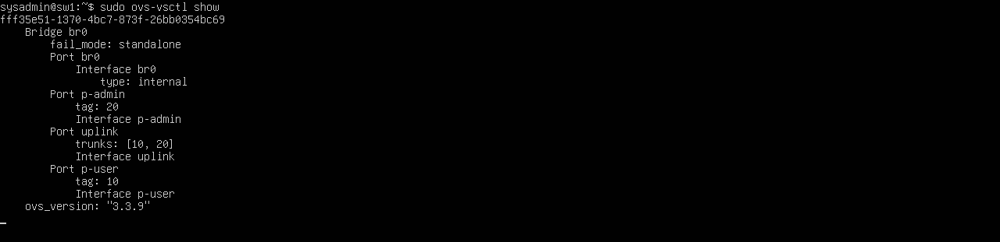

| **Figure 04** | SW2 |
|----|----|
| **Command** | sudo ovs-vsctl show |
| **Proves** | SW2: trunk 10–50 to the Core, 10,20 to SW1, 40,50 to SW3; DMZ access ports only (VLAN 30) |

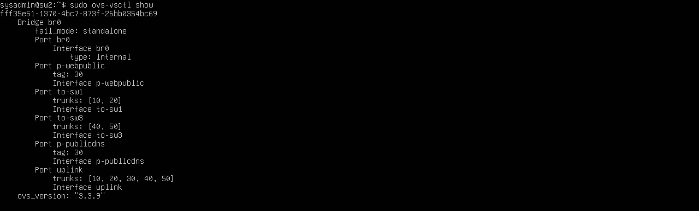

| **Figure 05** | SW3 |
|----|----|
| **Command** | sudo ovs-vsctl show |
| **Proves** | SW3: trunk 40,50; access VLAN 40 (AppsInternal) and VLAN 50 (AD, DHCP, PrivateDNS) |

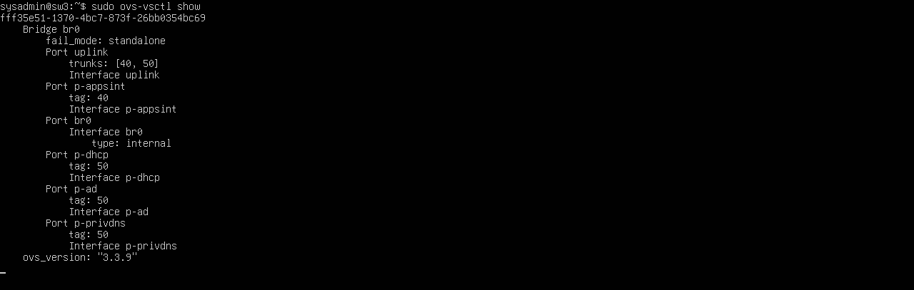

| **Figure 06** | Core |
|----|----|
| **Command** | for v in 10 20 30 40 50; do ip -d link show vl\$v \| head -3; done |
| **Proves** | Each zone is a real 802.1Q sub-interface (vlan protocol 802.1Q id N) on the Core trunk |

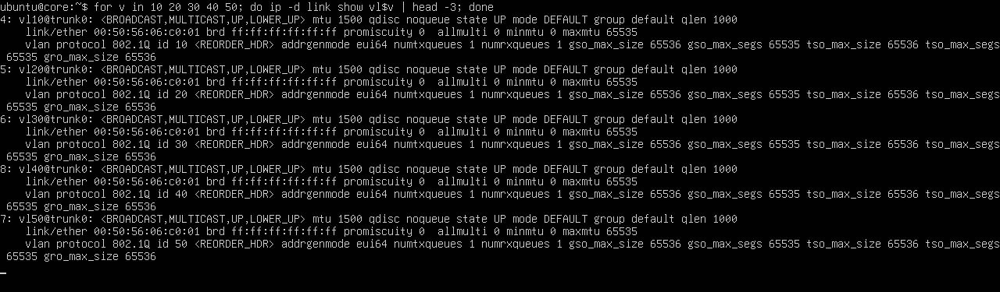

| **Figure 07** | Core |
|----|----|
| **Command** | ip -br a |
| **Proves** | The Core is the gateway of every VLAN; transit 192.168.6.146/30 |

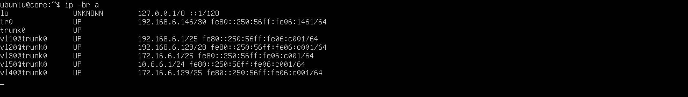

| **Figure 08** | Edge |
|----|----|
| **Command** | ip -br a |
| **Proves** | Edge: wan0 (VMware NAT), out0 10.10.10.1/24, tr0 192.168.6.145/30 |

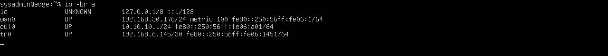

## 3.2 Routing (OSPF)

| **Figure 09a** | Edge                                  |
|----------------|---------------------------------------|
| **Command**    | sudo vtysh -c "show ip ospf neighbor" |
| **Proves**     | OSPF adjacency with the Core is Full  |

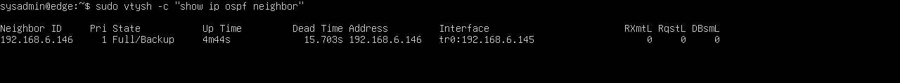

| **Figure 09b** | Core                                  |
|----------------|---------------------------------------|
| **Command**    | sudo vtysh -c "show ip ospf neighbor" |
| **Proves**     | OSPF adjacency with the Edge is Full  |

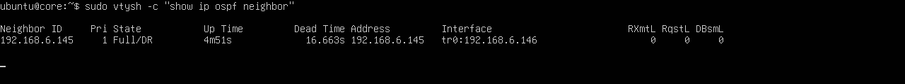

| **Figure 10** | Core |
|----|----|
| **Command** | sudo vtysh -c "show ip route" |
| **Proves** | Default route and Outside network learned by OSPF (O\>\*); no static routes |

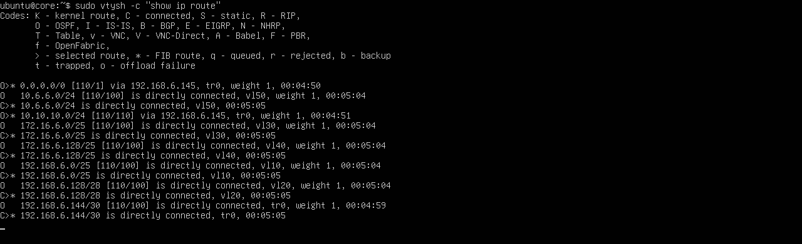

| **Figure 11** | Core |
|----|----|
| **Command** | sudo vtysh -c "show ip ospf interface tr0" |
| **Proves** | Cryptographic (MD5) authentication on the transit; VLAN interfaces are passive |

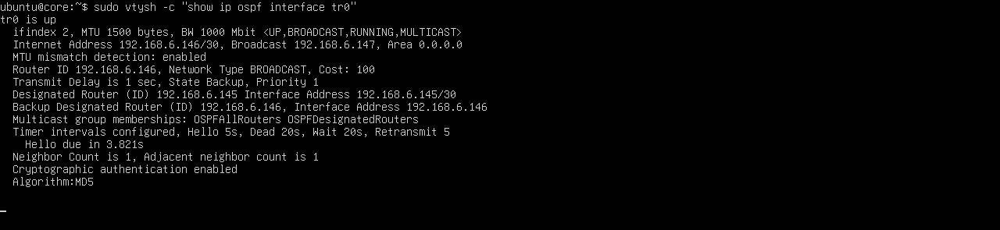

## 3.3 Firewalls

| **Figure 12a** | Core                                                  |
|----------------|-------------------------------------------------------|
| **Command**    | sudo nft list chain inet filter forward \| head -24   |
| **Proves**     | policy drop, per-VLAN anti-spoofing, first zone rules |

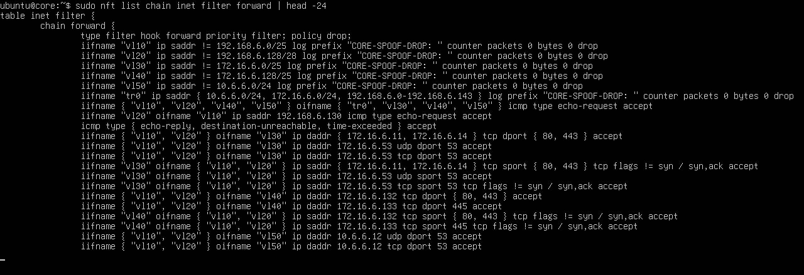

| **Figure 12b** | Core |
|----|----|
| **Command** | sudo nft list chain inet filter forward \| sed -n '25,48p' |
| **Proves** | Admin-only management, Users→Admin denied, Outside→DMZ web/DNS only |

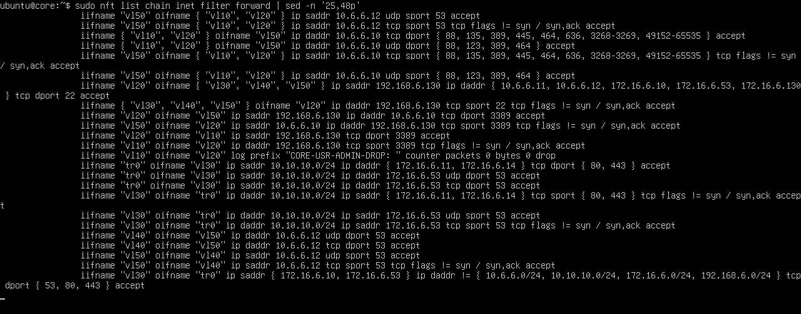

| **Figure 13a** | Core |
|----|----|
| **Command** | sudo nft list chain inet filter forward \| grep -c "ct state" |
| **Proves** | 0 = no connection tracking in the zone rules (stateless) |

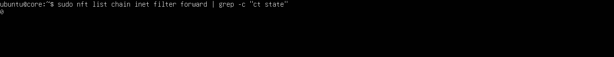

| **Figure 13b** | Edge |
|----|----|
| **Command** | sudo nft list chain inet filter forward \| grep -c "ct state" |
| **Proves** | 0 = stateless perimeter firewall |

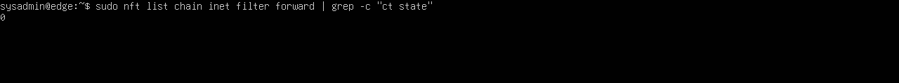

## 3.4 Network services and applications

| **Figure 14** | Core                                                   |
|---------------|--------------------------------------------------------|
| **Command**   | systemctl status isc-dhcp-relay --no-pager \| head -12 |
| **Proves**    | DHCP relay active on the Core                          |

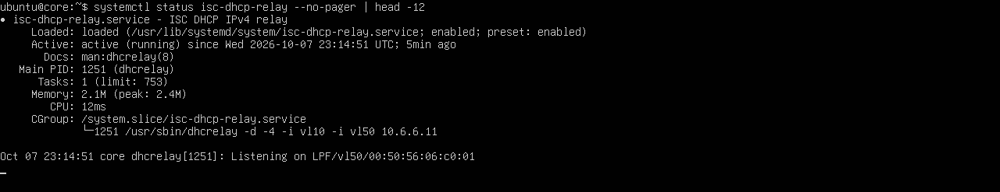

| **Figure 15** | DHCP |
|----|----|
| **Command** | awk '/^lease 192.168.6.5/,/^}/' /var/lib/dhcp/dhcpd.leases \| tail -14 |
| **Proves** | Lease for the User PC (MAC 00:50:56:06:10:20) in VLAN 10 |

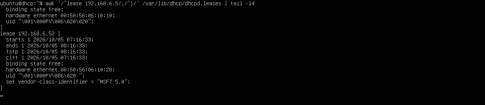

| **Figure 16** | PrivateDNS                                  |
|---------------|---------------------------------------------|
| **Command**   | grep -A8 "acl" /etc/bind/named.conf.options |
| **Proves**    | Private DNS accepts only internal subnets   |

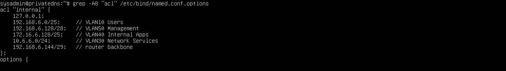

| **Figure 17** | PublicDNS                                           |
|---------------|-----------------------------------------------------|
| **Command**   | cat /etc/bind/db.group6.local.public                |
| **Proves**    | Public zone publishes only corpweb / esite / pubdns |

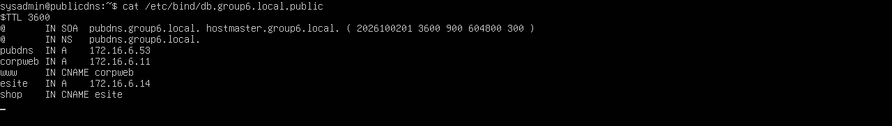

| **Figure 18** | WebPublic |
|----|----|
| **Command** | sudo docker ps --format "table {{.Names}}\t{{.Image}}\t{{.Status}}" |
| **Proves** | DMZ host runs only Joomla, PrestaShop and MariaDB |

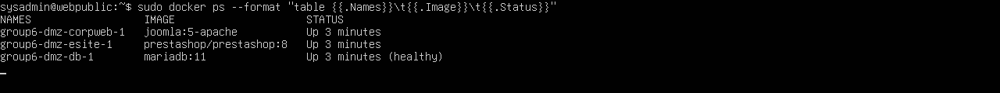

| **Figure 19** | AppsInternal |
|----|----|
| **Command** | sudo docker ps --format "table {{.Names}}\t{{.Image}}\t{{.Status}}" |
| **Proves** | Internal host runs only Odoo, PostgreSQL and Samba |

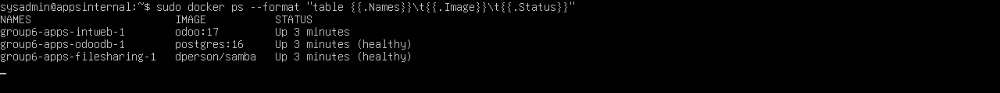

| **Figure 20** | WebPublic |
|----|----|
| **Command** | sudo docker network ls |
| **Proves** | Databases on private internal Docker networks (be_joomla, be_presta) |

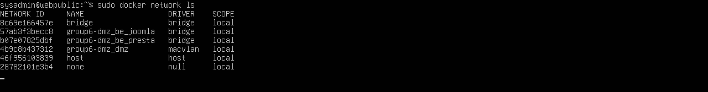

| **Figure 21** | AD (GROUP6\Administrator) |
|----|----|
| **Command** | Get-ADUser / Get-ADComputer / Get-ADGroupMember 'Domain Admins' |
| **Proves** | Domain accounts employee1 and itadmin; ADMIN and USER joined to the domain |

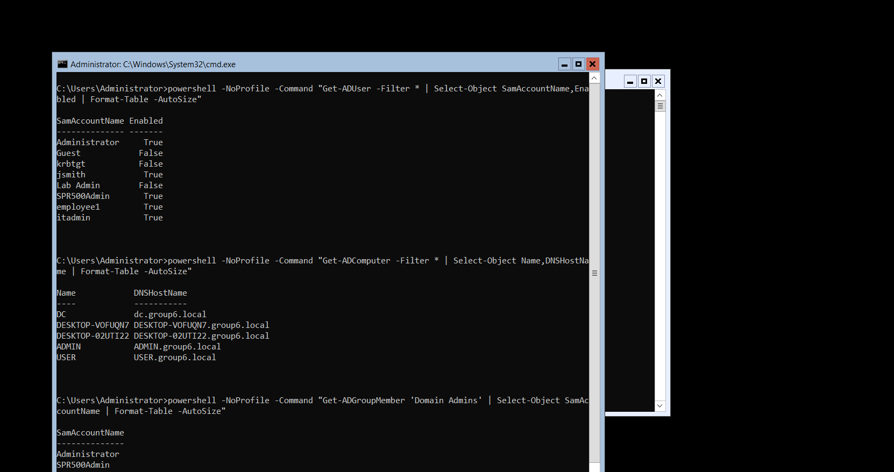

# 4. Test case execution

Business requirements and test cases are defined in Table 1 of the migration plan. Results:

| **Req_ID** | **Requirement (short)** | **Result** | **Evidence** |
|----|----|----|----|
| BR-01 | Separate zones / address blocks | **PASS** | Fig 06, 07, 08, 23, 29b, 30 |
| BR-02 | 802.1Q VLANs on Open vSwitch VMs | **PASS** | Fig 03, 04, 05, 06, 36, 37 |
| BR-03 | OSPF replaces static routing | **PASS** | Fig 09a, 09b, 10 |
| BR-04 | OSPF protected (MD5) | **PASS** | Fig 11 (rogue-router test not performed) |
| BR-05 | Public sites reachable from the Outside (80/443 only) | **PASS** | Fig 32, 32b, 42 |
| BR-06 | Internal apps / zones not reachable from the Outside | **PASS** | Fig 33, 38, 39, 43 |
| BR-07 | Employees use Joomla, Odoo, PrestaShop, file share | **PASS** | Fig 25, 26, 27, 27b |
| BR-08 | Private DNS for authorized endpoints only | **PASS** | Fig 16, 29, 34 |
| BR-09 | Public DNS: any client, public names only, no recursion | **PASS** | Fig 17, 32a, 34 |
| BR-10 | Clients use private DNS; AD separate from DNS | **PASS** | Fig 24, 29 |
| BR-11 | Domain-joined workstations, domain logon | **PASS** | Fig 21, 24, 30b |
| BR-12 | DHCP for Users through the Core relay | **PASS** | Fig 14, 15, 23 |
| BR-13 | Management only from the Admin PC | **PASS** | Fig 28, 31, 31b, 31c |
| BR-14 | Admin PC isolated from Users (no reach, no spoofing) | **PASS** | Fig 12b, 28, 30 (spoofing test logged CORE-SPOOF-DROP; no screenshot) |
| BR-15 | Compromised DMZ server cannot reach internal zones | **Partial** | Rules in Fig 12a/12b; live test from the DMZ not captured |
| BR-16 | Internet access through the Edge (NAT) | **PASS** | Fig 08, 10 (automated test: User → https://1.1.1.1 True; no screenshot) |
| BR-17 | Stateless default-deny firewalls with logging | **PASS** | Fig 12a, 12b, 13a, 13b, 38, 39, 40 |
| BR-18 | Databases never reachable | **PASS** | Fig 20, 28, 42 |
| BR-19 | No default credentials | **Not shown** | Unique passwords configured; not demonstrated in a screenshot |
| BR-20 | Public and internal apps on separate servers / VLANs | **PASS** | Fig 18, 19 |

## 4.1 Employee (User PC)

| **Figure 23** | User PC (GROUP6\employee1) |
|----|----|
| **Command** | ipconfig /all |
| **Proves** | 192.168.6.52/25 from DHCP server 10.6.6.11 via the Core relay; gateway 192.168.6.1; DNS 10.6.6.12 |

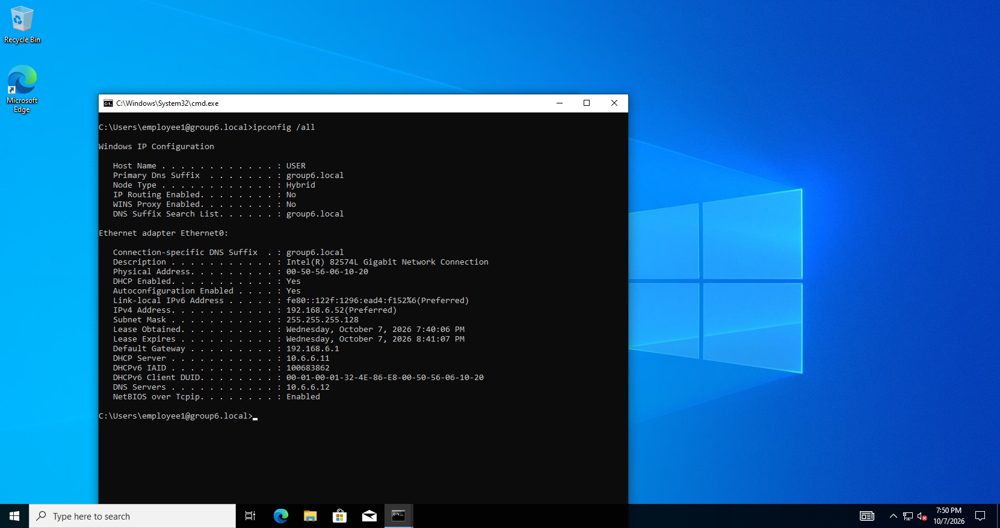

| **Figure 24** | User PC |
|----|----|
| **Command** | whoami & nltest /dsgetdc:group6.local |
| **Proves** | Domain logon as group6\employee1; DC dc.group6.local (10.6.6.10) located |

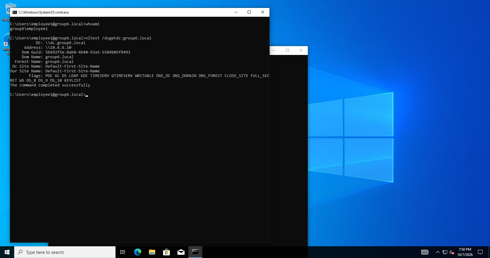

| **Figure 25** | User PC – Edge              |
|---------------|-----------------------------|
| **Command**   | http://corpweb.group6.local |
| **Proves**    | Joomla corporate site       |

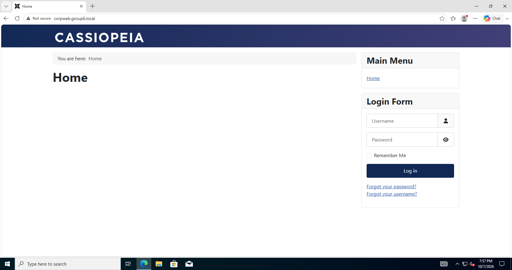

| **Figure 26** | User PC – Edge                    |
|---------------|-----------------------------------|
| **Command**   | http://intweb.group6.local        |
| **Proves**    | Odoo login (internal application) |

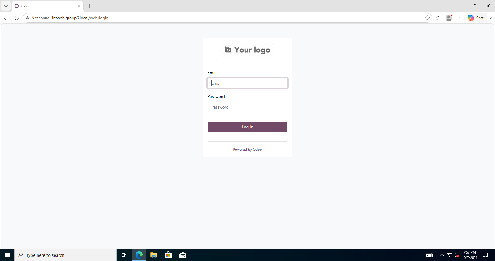

| **Figure 27** | User PC – Edge            |
|---------------|---------------------------|
| **Command**   | http://esite.group6.local |
| **Proves**    | PrestaShop online store   |

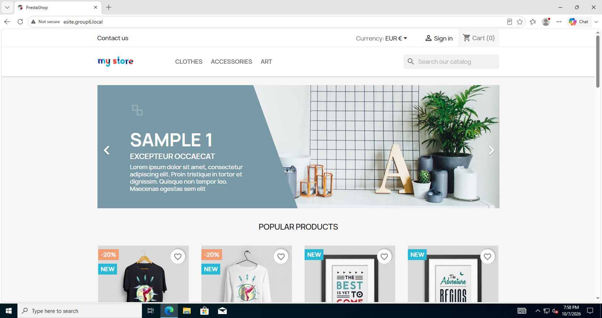

| **Figure 27b** | User PC                     |
|----------------|-----------------------------|
| **Command**    | dir \\\172.16.6.133\share   |
| **Proves**     | File share lists readme.txt |

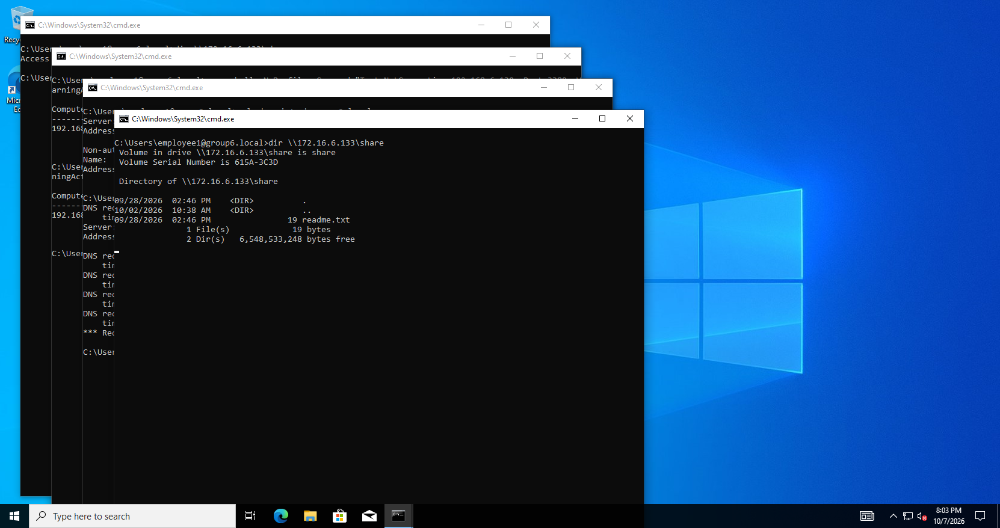

*Note: the share was first connected in a hidden step ('net use … /user:g6user \<password\>') so the password is not shown.*

| **Figure 28** | User PC |
|----|----|
| **Command** | Test-NetConnection 192.168.6.130:3389 · 192.168.6.129:22 · 172.16.6.11:3306 |
| **Proves** | Admin PC, Core management and MariaDB all unreachable (False) |

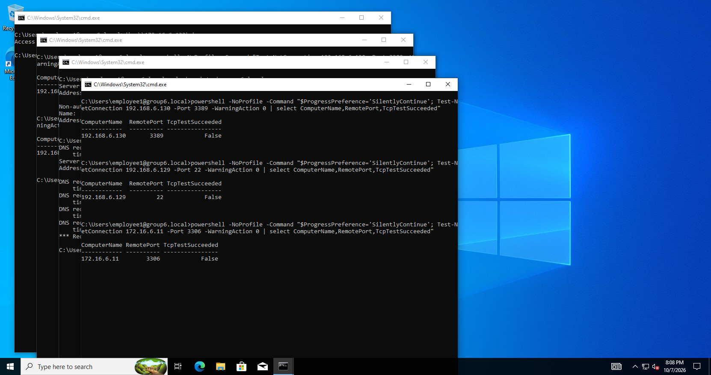

| **Figure 29** | User PC |
|----|----|
| **Command** | nslookup intweb.group6.local & nslookup group6.local 10.6.6.10 |
| **Proves** | Private DNS answers; direct query to AD DNS times out |

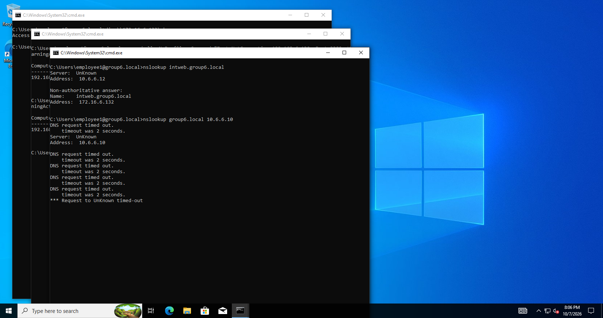

| **Figure 29b** | User PC |
|----|----|
| **Command** | tracert -d -w 1000 172.16.6.11 |
| **Proves** | Traffic to the DMZ is routed through the Core (192.168.6.1) |

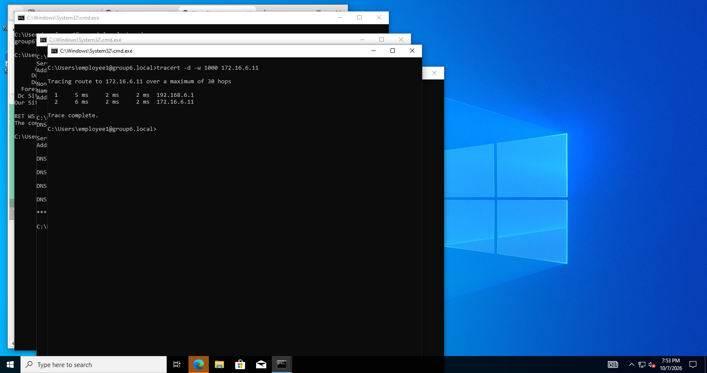

## 4.2 Administrator (Admin PC)

| **Figure 30** | Admin PC (GROUP6\itadmin)                          |
|---------------|----------------------------------------------------|
| **Command**   | ipconfig                                           |
| **Proves**    | 192.168.6.130/28 in VLAN 20, gateway 192.168.6.129 |

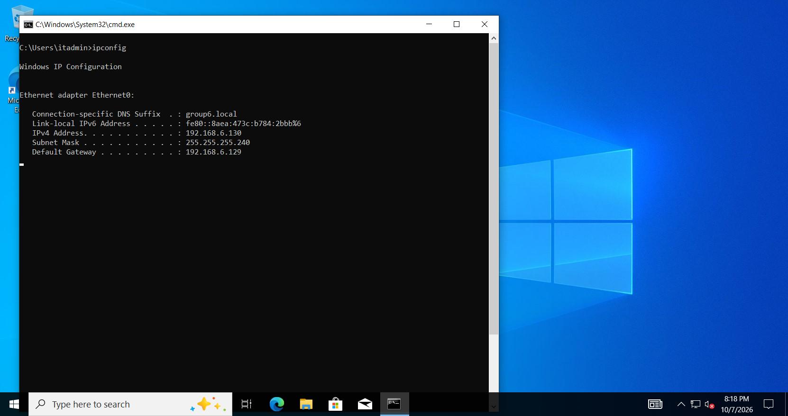

| **Figure 30b** | Admin PC                                              |
|----------------|-------------------------------------------------------|
| **Command**    | whoami & whoami /groups \| findstr /i "Domain Admins" |
| **Proves**     | group6\itadmin, member of GROUP6\Domain Admins        |

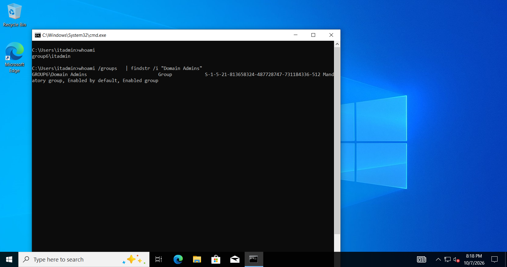

| **Figure 31** | Admin PC |
|----|----|
| **Command** | Test-NetConnection 192.168.6.129 / .145 / 10.6.6.12 / 172.16.6.130 -Port 22 |
| **Proves** | SSH to Core, Edge, PrivateDNS and AppsInternal reachable from the Admin PC (True) |

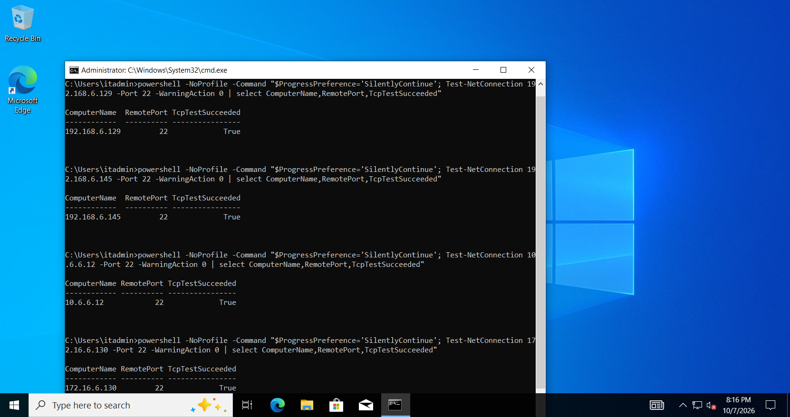

| **Figure 31b** | Admin PC |
|----|----|
| **Command** | ssh -o BatchMode=yes -o StrictHostKeyChecking=no ubuntu@192.168.6.129 |
| **Proves** | The Core's SSH server answers the Admin PC |

| **Figure 31c** | Admin PC |
|----|----|
| **Command** | Test-NetConnection 10.6.6.10 -Port 3389 |
| **Proves** | RDP to the domain controller allowed from the Admin PC (True) |

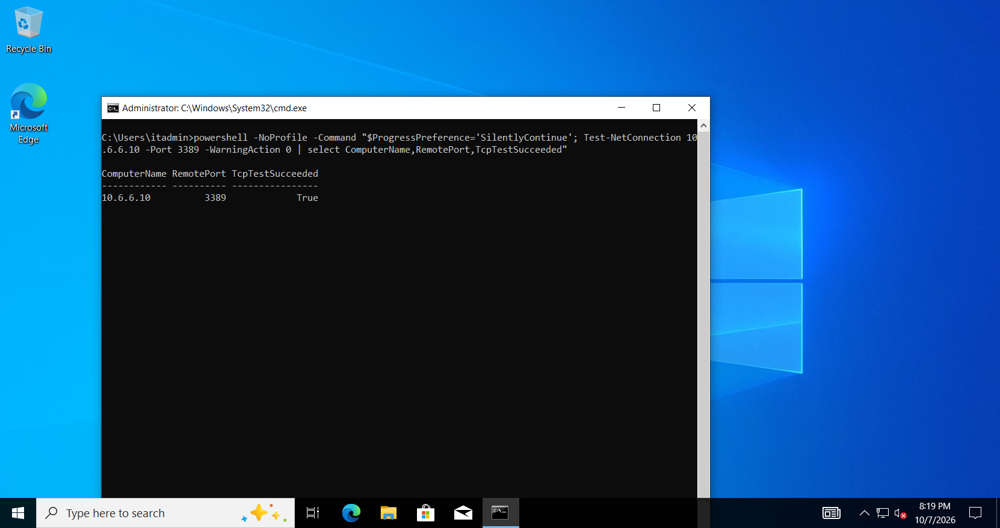

## 4.3 Outside user

| **Figure 32a** | Outside PC (labadmin) |
|----|----|
| **Command** | ipconfig /all |
| **Proves** | 10.10.10.2, gateway 10.10.10.1, DNS 172.16.6.53 (public DNS) |

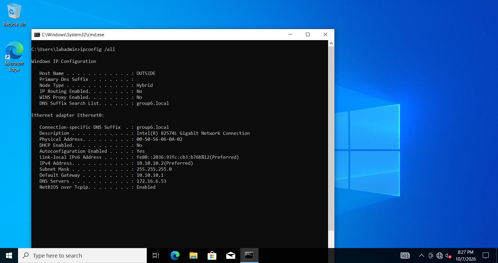

| **Figure 32** | Outside PC – Edge                         |
|---------------|-------------------------------------------|
| **Command**   | http://corpweb.group6.local               |
| **Proves**    | Public website reachable from the Outside |

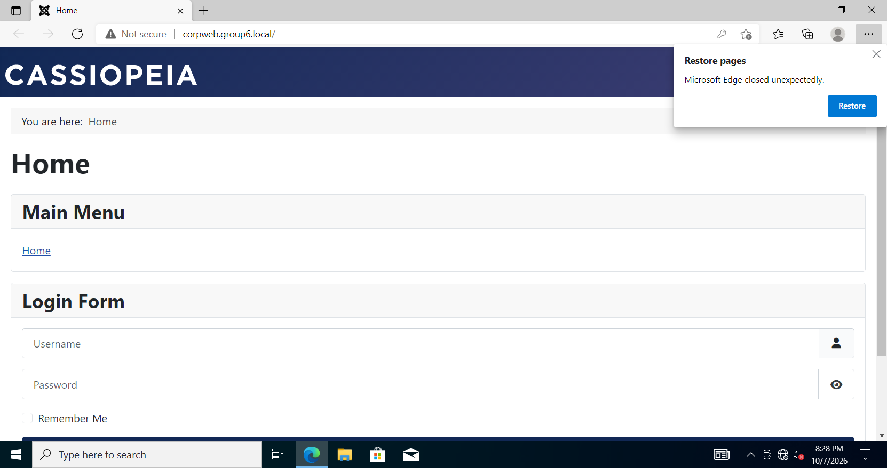

| **Figure 32b** | Outside PC – Edge                       |
|----------------|-----------------------------------------|
| **Command**    | http://esite.group6.local               |
| **Proves**     | Online store reachable from the Outside |

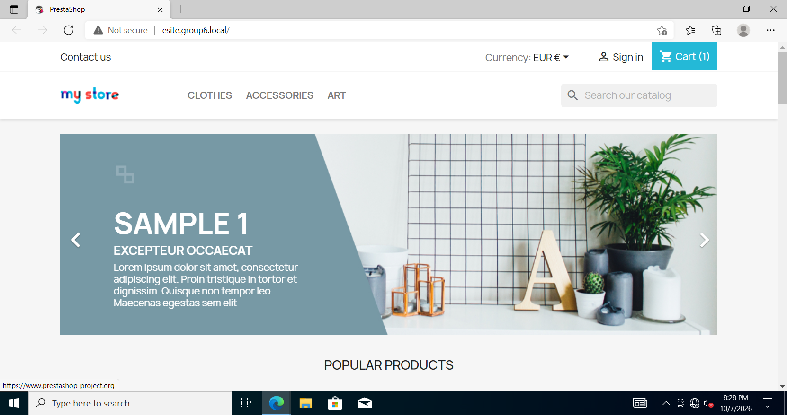

| **Figure 33** | Outside PC – Edge |
|----|----|
| **Command** | http://172.16.6.132 |
| **Proves** | Internal Odoo not reachable from the Outside (ERR_CONNECTION_TIMED_OUT) |

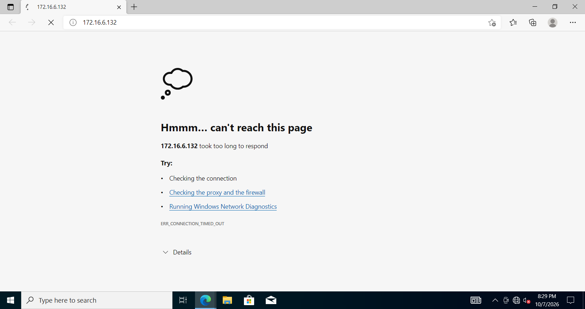

| **Figure 34** | Outside PC |
|----|----|
| **Command** | nslookup corpweb / intweb / google.com 10.6.6.12 |
| **Proves** | Public name resolves; internal name non-existent; private DNS times out |

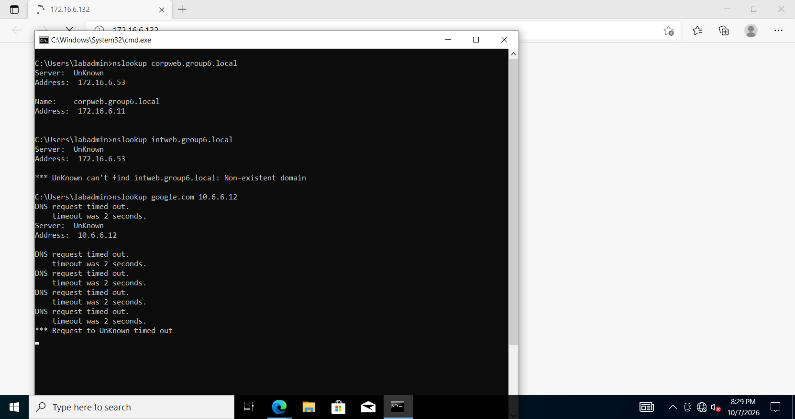

# 5. Network proof

Figures 36 and 37 show the same zone traffic tagged on the trunk and untagged on the access port, proving that VLAN separation is done by the virtual switches. Figures 38–40 show the firewalls enforcing the zone boundaries.

| **Figure 36** | SW2 |
|----|----|
| **Command** | sudo tcpdump -e -n -i uplink vlan -c 14 |
| **Proves** | Every frame on the Core↔SW2 trunk carries an 802.1Q header (0x8100, vlan 30) – handshake, HTTP GET and 200 OK |

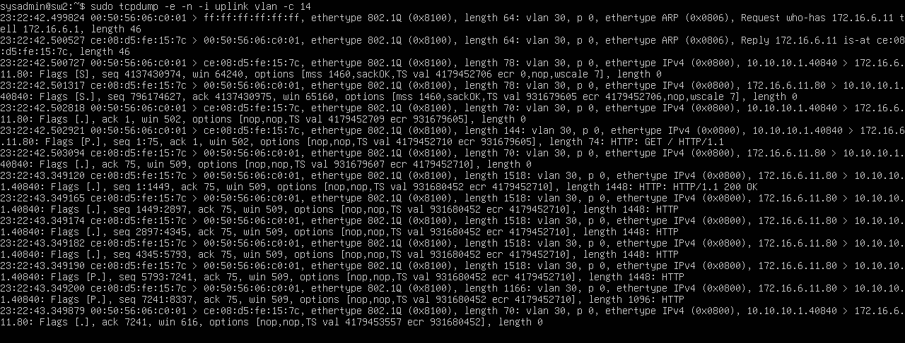

| **Figure 37** | SW1 |
|----|----|
| **Command** | sudo tcpdump -e -n -i p-user -c 12 tcp |
| **Proves** | On the User access port frames are untagged (ethertype IPv4); compare Figure 36 |

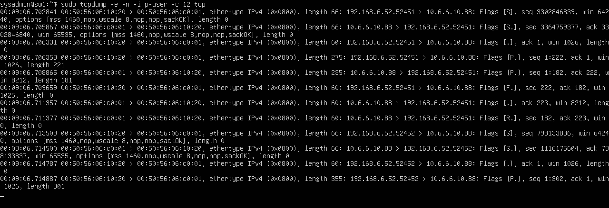

| **Figure 38** | Core |
|----|----|
| **Command** | sudo journalctl -k -g "CORE-" --since "10 min ago" --no-pager \| tail -12 |
| **Proves** | Outside attempts to Odoo and AD dropped and logged by the Core |

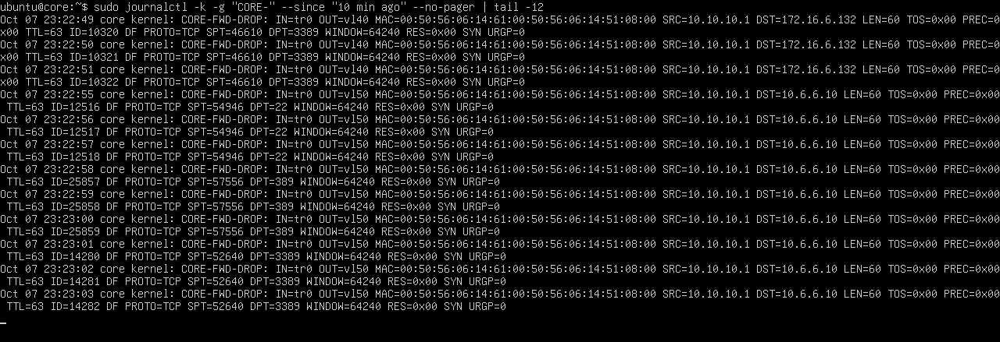

| **Figure 39** | Edge |
|----|----|
| **Command** | sudo journalctl -k -g "EDGE-FWD-DROP" --since "8 min ago" --no-pager \| tail -12 |
| **Proves** | Attacker (10.10.10.3) probes dropped at the perimeter (IN=out0) |

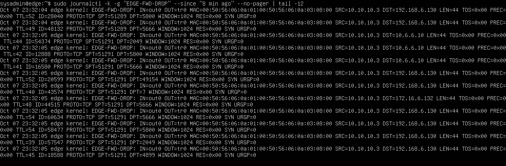

| **Figure 40** | Core |
|----|----|
| **Command** | sudo nft list chain inet filter forward \| grep -E "counter packets \[1-9\]" |
| **Proves** | Default-deny rule counting dropped packets |

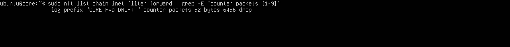

# 6. Vulnerability scans and TVRA

| **Item** | **Value** |
|----|----|
| Scan type | Non-authenticated, external (from the Outside network, attacker 10.10.10.3) |
| Scanner tools | Nmap 7.95 (port and service scan), Nikto 2.5.0 (web server scanner) |
| Targets | DMZ: 172.16.6.11 (Joomla), 172.16.6.14 (PrestaShop), 172.16.6.53 (public DNS); internal: 172.16.6.132, 10.6.6.10, 192.168.6.130 |
| Not performed | Authenticated scans and a second web scanner (e.g. OWASP ZAP) |

| **Figure 42** | Attacker (Kali) |
|----|----|
| **Command** | sudo nmap -sV -Pn 172.16.6.11 172.16.6.14 172.16.6.53 \| grep -v "^SF" |
| **Proves** | Only 80/tcp (Apache) and 53/tcp answer; 443 closed; versions disclosed |

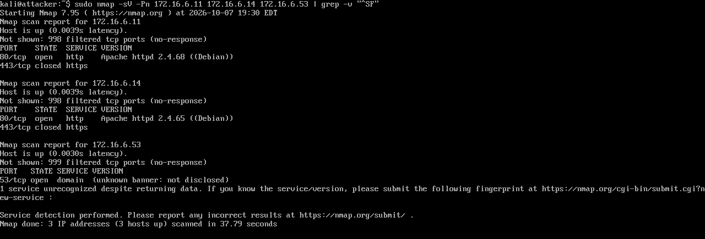

*Note: '\| grep -v "^SF"' removes nmap's raw service-fingerprint block.*

| **Figure 43** | Attacker (Kali) |
|----|----|
| **Command** | sudo nmap -Pn --top-ports 100 172.16.6.132 10.6.6.10 192.168.6.130 |
| **Proves** | Odoo, AD and the Admin PC are up but every port is filtered from the Outside |

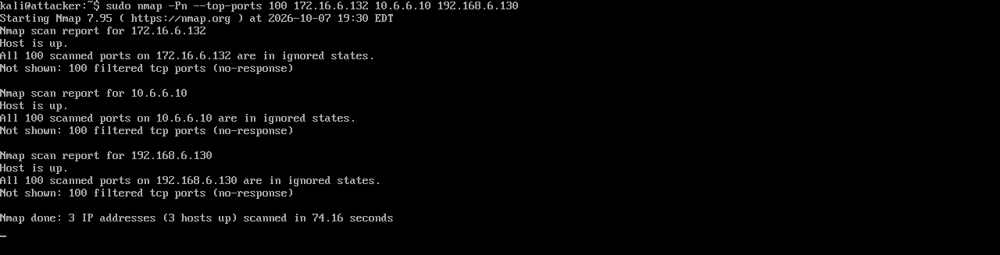

| **Figure 44** | Attacker (Kali) |
|----|----|
| **Command** | nikto -h http://corpweb.group6.local -maxtime 180s \| cut -c1-158 |
| **Proves** | 25 web-server findings for the public Joomla site |

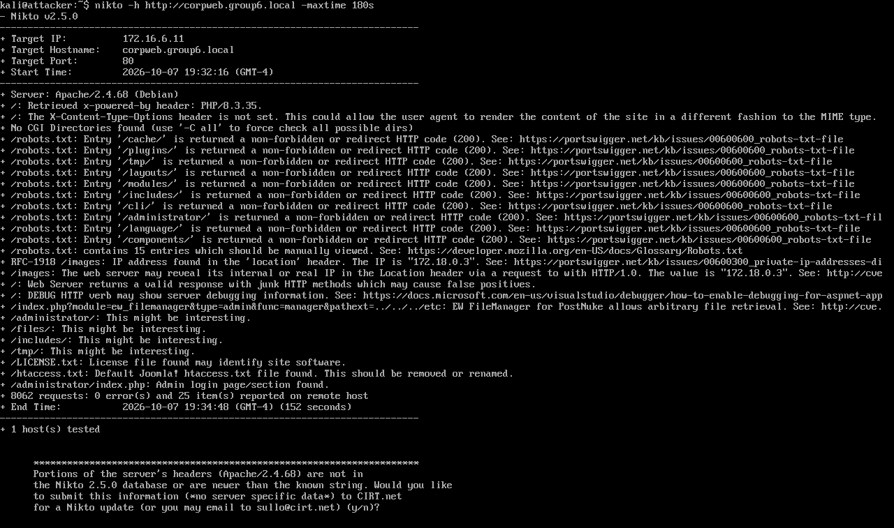

*Note: lines were cut at 158 characters to fit the console; the prompt line in the image shows the command without '\| cut -c1-158'.*

## 6.1 Key findings

- Only HTTP 80 (Apache) and DNS 53 are exposed to the Outside; every internal host is filtered (Fig 42, 43).

- Port 443 is allowed by the firewalls but closed – HTTPS is not configured, so web traffic is unencrypted.

- Server and PHP versions (Apache 2.4.68, PHP 8.3.35) and an internal Docker address (172.18.0.3) are disclosed in HTTP headers (Fig 44).

- robots.txt reveals the Joomla /administrator/ login page; HTTP DEBUG method allowed; X-Content-Type-Options header missing (Fig 44).

- Stale Lab 1 accounts (jsmith, SPR500Admin – a Domain Admin) and stale computer objects remain in AD (Fig 21).

## 6.2 Threat and vulnerability risk assessment (TVRA)

*Qualitative scale: VL = very low, L = low, M = moderate, H = high, VH = very high. Draft ratings – review as a team.*

| **Threat event** | **Threat sources** | **Capab.** | **Intent** | **Target.** | **Relevance** | **Likelihood of attack initiation** | **Vulnerabilities and predisposing conditions** | **Severity / pervasiveness** | **Likelihood attack succeeds** | **Overall likelihood** | **Level of impact** | **Risk** |
|----|----|----|----|----|----|----|----|----|----|----|----|----|
| Credential attack on the Joomla administrator page | External attacker | M | H | H | Confirmed | H | /administrator reachable from the Internet and listed in robots.txt (Fig 44) | M | L | M | H | Moderate |
| Interception of user data over plain HTTP | External attacker on the path | M | M | M | Possible | M | Sites served on port 80 only; 443 closed (Fig 42) | H | M | M | M | Moderate |
| Reconnaissance using disclosed versions / internal IP | External attacker | L | M | M | Confirmed | H | Apache/PHP versions and 172.18.0.3 in headers (Fig 42, 44) | H | M | M | L | Low |
| Web attacks via default config (DEBUG method, missing headers) | External attacker | M | M | M | Possible | M | Default Apache/Joomla configuration (Fig 44) | M | L | L | M | Low |
| Misuse of stale privileged accounts | Insider / leaked credentials | M | H | H | Possible | M | jsmith and SPR500Admin (Domain Admin) still enabled; stale computers (Fig 21) | M | M | M | VH | Moderate |
| Lateral movement from a compromised DMZ server | External attacker | H | H | M | Possible | M | DMZ servers are internet-facing; mitigated by Core default deny (Fig 12, 38) | L | L | L | H | Low |
| Scanning of internal hosts from the Outside | External attacker | L | M | M | Confirmed | VH | Mitigated – internal VLANs filtered at Edge and Core (Fig 39, 43) | L | VL | L | M | Low |

## 6.3 Recommended mitigations

- Enable HTTPS on CorpWeb and E-Site and redirect 80 → 443.

- Restrict /administrator (Joomla) and /admin-g6 (PrestaShop) to the Admin VLAN at the Edge/Core.

- Hide server banners (ServerTokens Prod, expose_php Off), add security headers, disable unused HTTP methods.

- Disable or delete stale AD accounts and computer objects; review Domain Admins membership.

- Run authenticated scans (e.g. OpenVAS/Greenbone) and a second web scanner (OWASP ZAP).

# 7. Logbook

*Times are approximate and each task is 30 minutes or less. Fill in the task owner for each entry.*

| **From (date time)** | **To** | **Task description and reason** | **Evaluation and justification** | **Req_ID** | **Task owner** |
|----|----|----|----|----|----|
| 2026-09-28 13:30 | 13:55 | Inventory existing Lab 1 VMs and Lab 2 requirements; agree addressing per zone (x = 6) | Baseline needed before changes | BR-01 |  |
| 2026-09-28 14:00 | 14:25 | Copy R1, clone AD and DHCP into the Lab 2 folder; back up configs | Original Lab 1 VMs kept unchanged for rollback | — |  |
| 2026-09-28 14:30 | 14:55 | Create LAN segments and unattended Ubuntu 24.04 template | Repeatable server builds | — |  |
| 2026-09-28 15:00 | 15:30 | Build Edge router: interfaces, NAT, OSPF, perimeter firewall | Internet path + perimeter control | BR-03/16/17 |  |
| 2026-09-28 15:30 | 16:00 | Configure core routing, OSPF with MD5, DHCP relay | Replace static routes | BR-03/04/12 |  |
| 2026-09-28 16:00 | 16:30 | Re-address DHCP server and Users scope | Central DHCP for the Users zone | BR-12 |  |
| 2026-09-28 16:30 | 17:00 | Build PrivateDNS (internal only) and PublicDNS (public, no recursion) | Split DNS requirement | BR-08/09/10 |  |
| 2026-09-28 17:00 | 17:30 | Build container host; first automated test run (fixed TCP reply rule on Edge) | Verify design early | BR-17 |  |
| 2026-09-30 10:00 | 10:30 | Install VMware Tools on AD; move AD to 10.6.6.10 and update DNS records | AD in the infrastructure zone | BR-10/11 |  |
| 2026-09-30 10:30 | 11:00 | Deploy Joomla, PrestaShop, Odoo with MariaDB/PostgreSQL in Docker | Migrate Lab 1 applications | BR-07/18 |  |
| 2026-09-30 11:00 | 11:30 | Fix PrestaShop install (temporary Internet rule removed afterwards); set strong app passwords | Working apps, no default credentials | BR-19 |  |
| 2026-09-30 11:30 | 12:00 | Unattended Windows 10 installs for User, Admin, OutsideUser; clone Kali attacker | Desktop clients for testing | — |  |
| 2026-10-02 10:00 | 10:30 | Split DMZ: public apps (WebPublic) vs internal apps (AppsInternal) | Stronger segregation | BR-20 |  |
| 2026-10-02 10:30 | 11:00 | Create domain users employee1/itadmin; join User and Admin PCs to group6.local | Domain logon | BR-11 |  |
| 2026-10-02 11:00 | 11:30 | Move Admin PC to its own VLAN; anti-spoofing; spoofing test | Protect the management host | BR-13/14 |  |
| 2026-10-05 10:00 | 10:30 | Agree final topology with the team (Edge → Core → Open vSwitch) | Professor's required design | BR-02 |  |
| 2026-10-05 10:30 | 11:00 | Build three Open vSwitch VMs and rewire all VMs to switch ports | Real 802.1Q VLANs | BR-02 |  |
| 2026-10-05 11:00 | 11:30 | Reconfigure Core on 802.1Q sub-interfaces; new zone firewall; Edge update | Inter-VLAN routing at the Core | BR-01/17 |  |
| 2026-10-05 11:30 | 12:00 | Re-test all zones, Admin/User/Outside PCs and Kali (all passed) | Validate the rebuild | All |  |
| 2026-10-05 12:00 | 12:20 | Move VLAN 40 to SW3 so the DMZ switch serves only DMZ hosts | Keep external servers on their own switch | BR-02/20 |  |
| 2026-10-05 12:20 | 12:50 | Update migration plan, diagram and test scripts | Documentation matches the build | — |  |
| 2026-10-07 18:55 | 19:20 | Infrastructure screenshots (switches, VLANs, OSPF, firewall, services) | Deployment evidence | BR-01–04/17 |  |
| 2026-10-07 19:20 | 19:30 | Network proof: tagged/untagged captures and drop logs; fix Core DNS link (vl50) | Prove VLAN tagging and enforcement | BR-02/17 |  |
| 2026-10-07 19:30 | 19:40 | External scans from Kali (Nmap, Nikto) | Vulnerability assessment | TVRA |  |
| 2026-10-07 19:40 | 20:10 | User PC screenshots (domain, apps, file share, blocked access, DNS, route) | Employee test cases | BR-07–14 |  |
| 2026-10-07 20:10 | 20:35 | Admin and Outside PC screenshots; AD users/computers | Admin and Outside test cases | BR-05/06/09/11/13 |  |
| 2026-10-07 20:35 | 21:00 | Compile final report, TVRA table and logbook | Submission | — |  |

# 8. Known limitations

- Stateless filtering allows any non-SYN TCP packet as a 'reply'; host firewalls and NAT on the Edge use connection tracking.

- Web applications are served over HTTP only; HTTPS is recommended (see 6.3).

- The Outside network has no Internet access by design (it represents the Internet side).

- Lab-only shortcuts: UAC disabled on the Windows 10 VMs and password-less sudo for the lab admin user on Linux clones; Windows not activated.

- Everything runs on one 16 GB host; desktops are run one at a time.

---

*Group 6 work. Contributors: [@rabbiaman03](https://github.com/rabbiaman03), [@cybersaviour-AS](https://github.com/cybersaviour-AS).*
