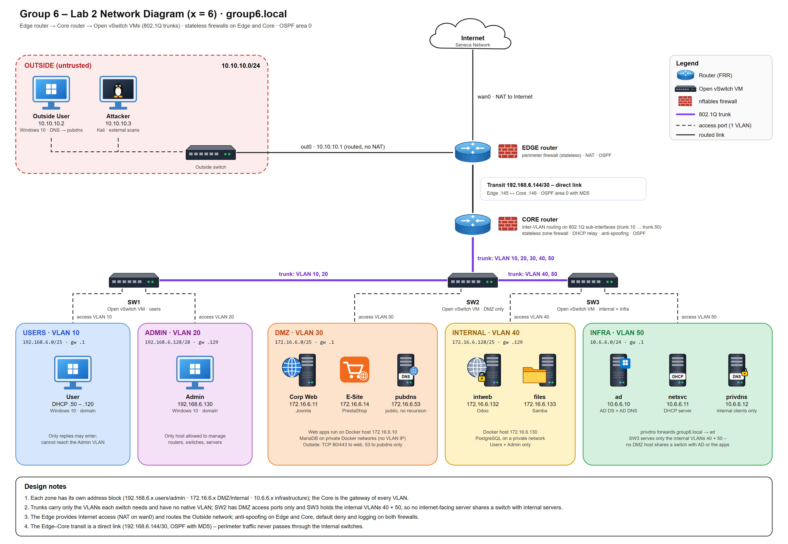

# Contents

[1. Network design diagram](#network-design-diagram)

[2. Business requirements](#business-requirements)

[3. Network devices and addressing](#network-devices-and-addressing)

[4. Software](#software)

[5. Security zones](#security-zones)

[6. Security zone boundaries](#security-zone-boundaries)

# 1. Network design diagram

*Figure 3 – Group 6 target topology: Edge router, Core router and three Open vSwitch switches joined by 802.1Q trunks; one VLAN per security zone*

# 2. Business requirements

| **Req_ID** | **Requirement description** | **Test case description** | **Acceptance criteria** |
|----|----|----|----|
| BR-01 | Separate the network into security zones – Users (VLAN 10), Admin (VLAN 20), DMZ (VLAN 30), Internal (VLAN 40), Infra (VLAN 50), Transit and Outside – each with its own address block derived from x = 6. | On the Core run 'ip -br a'; on SW1–SW3 run 'ovs-vsctl show'; check every host is on an access port of its zone. | Core: vl10 192.168.6.1/25, vl20 192.168.6.129/28, vl30 172.16.6.1/25, vl40 172.16.6.129/25, vl50 10.6.6.1/24, tr0 192.168.6.146/30. Every host is in exactly one VLAN. |
| BR-02 | Implement the zones as real 802.1Q VLANs on virtual switches (Open vSwitch VMs) instead of physical switches. | Run 'ovs-vsctl show' on SW1–SW3 and 'tcpdump -e -n -i uplink vlan' on SW2 while a user browses; run 'ip -d link show vl10' on the Core. | Access ports carry one VLAN tag; trunks carry only the VLANs listed (SW1 10,20 · SW2 10–50 · SW3 40,50); SW2 has DMZ access ports only with no native VLAN; captured frames show 802.1Q tags; Core sub-interfaces are 'vlan protocol 802.1Q'. |
| BR-03 | Replace static routing with OSPF (FRR) between the Edge and the Core. | On Edge and Core: 'vtysh -c "show ip ospf neighbor"' and 'show ip route ospf'. | The neighbour is Full; the Core learns 0.0.0.0/0 and 10.10.10.0/24 as 'O' routes and the Edge learns every internal VLAN; no static routes. |
| BR-04 | Protect the routing protocol against rogue routers. | 'show ip ospf interface tr0' on both routers; connect a router without the key. | MD5 authentication is shown on tr0; a router without the key never becomes a neighbour. All VLAN interfaces are passive. |
| BR-05 | Public services (CorpWeb – Joomla, E-Site – PrestaShop) are reachable from the Outside on HTTP/HTTPS only. | From the Outside User PC browse http://corpweb.group6.local and http://esite.group6.local; from Kali run 'nmap -Pn 172.16.6.11 172.16.6.14'. | Both sites load; nmap shows only 80/443 open, every other port filtered. |
| BR-06 | Internal applications (IntWeb – Odoo, FileSharing – Samba) and all internal zones are not reachable from the Outside. | From the Outside User PC browse http://172.16.6.132 and open \\\172.16.6.133; from Kali run 'nmap -Pn -p 22,80,389,445,3389 172.16.6.132 172.16.6.133 10.6.6.10 192.168.6.130'. | Browser and Explorer time out; nmap reports everything filtered; drops are logged (EDGE-FWD-DROP / CORE-FWD-DROP). |
| BR-07 | Employees can use all corporate applications (Joomla, Odoo, PrestaShop) and the file share. | On the User PC open http://corpweb.group6.local, http://intweb.group6.local and http://esite.group6.local, and \\\172.16.6.133\share in Explorer. | Joomla site, Odoo login page and PrestaShop shop load; the share opens with the g6user account. |
| BR-08 | Private DNS answers only authorized internal endpoints (Users, Admin, Internal, Infra). | Query 10.6.6.12 from the User PC, from the Outside User PC and from the DMZ. | The User PC gets answers (internal and Internet names); queries from the Outside and from the DMZ time out. |
| BR-09 | Public DNS (172.16.6.53, DMZ) answers any endpoint, exposes only public records and does not recurse. | From the Outside User PC run nslookup for corpweb, esite, intweb and ubuntu.com. | corpweb → 172.16.6.11, esite → 172.16.6.14; intweb returns Non-existent domain; ubuntu.com is refused. |
| BR-10 | Clients resolve names only through the private DNS; AD is a separate server from DNS. | On the User PC run 'nslookup intweb.group6.local', 'nltest /dsgetdc:group6.local' and 'nslookup group6.local 10.6.6.10'. | Names and the domain controller are found through 10.6.6.12; the direct query to AD times out. |
| BR-11 | Workstations are members of group6.local and users log on with domain accounts. | Log on to the User PC as GROUP6\employee1 and to the Admin PC as GROUP6\itadmin; run 'whoami'. | Logon succeeds; whoami shows the domain account. |
| BR-12 | The Users VLAN receives addresses from the central DHCP server in the Infra VLAN. | Start the User PC with DHCP; run 'ipconfig /all'; check isc-dhcp-relay on the Core. | The User PC receives 192.168.6.50–.120, gateway 192.168.6.1 and DNS 10.6.6.12 through the Core relay. |
| BR-13 | Routers and servers can be managed only from the Admin PC (192.168.6.130). | From the Admin PC: 'ssh ubuntu@192.168.6.129' (Core), 'ssh sysadmin@192.168.6.145' (Edge), 'mstsc /v:10.6.6.10'. Repeat the port tests from the User PC. | SSH and RDP work from the Admin PC only; from the User PC every management connection fails. |
| BR-14 | The Admin PC is isolated in its own VLAN: a compromised user PC can neither reach it nor impersonate it. | From the User PC run 'Test-NetConnection 192.168.6.130 -Port 3389'; then set the User PC to 192.168.6.130 and try SSH to the Core and RDP to AD; check the Core journal. | Every attempt fails; the Core logs CORE-USR-ADMIN-DROP and CORE-SPOOF-DROP (Admin address seen on VLAN 10). |
| BR-15 | A compromised DMZ server cannot reach the Users, Admin, Internal or Infra VLANs. | From the WebPublic host connect to 172.16.6.132:80, 172.16.6.133:445, 10.6.6.10:389 and query 10.6.6.12. | All attempts are blocked and logged (CORE-FWD-DROP). |
| BR-16 | Internal zones have Internet access through the Edge (NAT). | From the User PC open https://ubuntu.com; on the Linux servers run 'apt update'. | Connections succeed and leave with the Edge WAN address. |
| BR-17 | Zone boundaries use stateless firewalls with default deny, anti-spoofing and logging on the Edge and the Core. | Run 'nft list chain inet filter forward' on Edge and Core; send a disallowed packet and check the journal. | Forward chains have policy drop and no 'ct state' matches; drops are logged with the router prefix. |
| BR-18 | Application databases (MariaDB, PostgreSQL) are never reachable from any VLAN. | From the User PC run 'Test-NetConnection 172.16.6.11 -Port 3306' and '... 172.16.6.132 -Port 5432'; from Kali scan 3306/5432. | No database port is reachable; databases sit only on internal Docker networks (be_joomla, be_presta, be_odoo). |
| BR-19 | Applications and administrator accounts do not use default credentials. | Try admin/admin on Joomla (/administrator), Odoo and PrestaShop (/admin-g6). | Default credentials are rejected; each application uses a unique strong password. |
| BR-20 | Public and internal applications run on separate servers in separate VLANs. | Run 'docker ps' on WebPublic (VLAN 30) and AppsInternal (VLAN 40). | WebPublic runs only Joomla, PrestaShop and MariaDB; AppsInternal runs only Odoo, PostgreSQL and Samba. |

*Table 1 – List of business requirements*

# 3. Network devices and addressing

<table>
<colgroup>
<col style="width: 16%" />
<col style="width: 18%" />
<col style="width: 8%" />
<col style="width: 14%" />
<col style="width: 14%" />
<col style="width: 10%" />
<col style="width: 12%" />
<col style="width: 6%" />
</colgroup>
<thead>
<tr>
<th>
<strong>FQDN</strong>
</th>
<th>
<strong>Role</strong>
</th>
<th>
<strong>Interface</strong>
</th>
<th>
<strong>Old IP address (CIDR)</strong>
</th>
<th>
<strong>New IP address (CIDR)</strong>
</th>
<th>
<strong>Old gateway</strong>
</th>
<th>
<strong>New gateway</strong>
</th>
<th>
<strong>VLAN</strong>
</th>
</tr>
</thead>
<tbody>
<tr>
<td>
edge.group6.local
</td>
<td>
Edge router – perimeter firewall, NAT, OSPF
</td>
<td>
wan0

out0

tr0
</td>
<td>
DHCP (NAT)

10.10.10.1/24

192.168.6.145/30
</td>
<td>
DHCP (NAT)

10.10.10.1/24

192.168.6.145/30
</td>
<td>
VMware NAT
</td>
<td>
VMware NAT
</td>
<td>
—

Outside

Transit
</td>
</tr>
<tr>
<td>
core.group6.local
</td>
<td>
Core router – inter-VLAN routing, zone firewall, DHCP relay, OSPF
</td>
<td>
tr0

vl10

vl20

vl30

vl40

vl50
</td>
<td>
192.168.6.146/30

192.168.6.129/28 (LAN)

—

—

—

—
</td>
<td>
192.168.6.146/30

192.168.6.1/25

192.168.6.129/28

172.16.6.1/25

172.16.6.129/25

10.6.6.1/24
</td>
<td>
192.168.6.145 (static)
</td>
<td>
192.168.6.145 (OSPF)
</td>
<td>
Transit

10

20

30

40

50
</td>
</tr>
<tr>
<td>
sw1 (new)
</td>
<td>
Open vSwitch – Users/Admin access switch
</td>
<td>
uplink

p-user

p-admin
</td>
<td>
—
</td>
<td>
No IP (layer 2)
</td>
<td>
—
</td>
<td>
—
</td>
<td>
trunk 10,20

10

20
</td>
</tr>
<tr>
<td>
sw2 (new)
</td>
<td>
Open vSwitch – distribution + DMZ switch
</td>
<td>
uplink

to-sw1 / to-sw3

p-webpublic, p-publicdns
</td>
<td>
—
</td>
<td>
No IP (layer 2)
</td>
<td>
—
</td>
<td>
—
</td>
<td>
trunk 10–50

trunk 10,20 / 40,50

30
</td>
</tr>
<tr>
<td>
sw3 (new)
</td>
<td>
Open vSwitch – internal + infrastructure switch
</td>
<td>
uplink

p-appsint

p-ad, p-dhcp, p-privdns
</td>
<td>
—
</td>
<td>
No IP (layer 2)
</td>
<td>
—
</td>
<td>
—
</td>
<td>
trunk 40,50

40

50
</td>
</tr>
<tr>
<td>
admin.group6.local
</td>
<td>
Admin workstation – Windows 10, domain member
</td>
<td>
Ethernet0
</td>
<td>
192.168.6.130/28
</td>
<td>
192.168.6.130/28 (static)
</td>
<td>
192.168.6.129
</td>
<td>
192.168.6.129 (Core vl20)
</td>
<td>
20
</td>
</tr>
<tr>
<td>
user.group6.local
</td>
<td>
Employee workstation – Windows 10, domain member
</td>
<td>
Ethernet0
</td>
<td>
192.168.6.131/28
</td>
<td>
DHCP 192.168.6.50–.120
</td>
<td>
192.168.6.129
</td>
<td>
192.168.6.1 (Core vl10)
</td>
<td>
10
</td>
</tr>
<tr>
<td>
webpublic.group6.local
</td>
<td>
Docker host – public web applications (new)
</td>
<td>
dmz0
</td>
<td>
— (new)
</td>
<td>
172.16.6.10/25
</td>
<td>
—
</td>
<td>
172.16.6.1
</td>
<td>
30
</td>
</tr>
<tr>
<td>
corpweb.group6.local
</td>
<td>
Corporate website – Joomla (container)
</td>
<td>
eth0 (macvlan)
</td>
<td>
192.168.6.132/28
</td>
<td>
172.16.6.11/25
</td>
<td>
192.168.6.129
</td>
<td>
172.16.6.1
</td>
<td>
30
</td>
</tr>
<tr>
<td>
esite.group6.local
</td>
<td>
E-commerce – PrestaShop (container)
</td>
<td>
eth0 (macvlan)
</td>
<td>
192.168.6.132/28 (shared)
</td>
<td>
172.16.6.14/25
</td>
<td>
192.168.6.129
</td>
<td>
172.16.6.1
</td>
<td>
30
</td>
</tr>
<tr>
<td>
pubdns.group6.local
</td>
<td>
Public authoritative DNS (new)
</td>
<td>
dmz0
</td>
<td>
— (new)
</td>
<td>
172.16.6.53/25
</td>
<td>
—
</td>
<td>
172.16.6.1
</td>
<td>
30
</td>
</tr>
<tr>
<td>
db (container)
</td>
<td>
MariaDB for Joomla / PrestaShop
</td>
<td>
internal bridges
</td>
<td>
— (new)
</td>
<td>
Docker networks only
</td>
<td>
—
</td>
<td>
— (not routed)
</td>
<td>
30 (int.)
</td>
</tr>
<tr>
<td>
appsinternal.group6.local
</td>
<td>
Docker host – internal applications (new)
</td>
<td>
app0
</td>
<td>
— (new)
</td>
<td>
172.16.6.130/25
</td>
<td>
—
</td>
<td>
172.16.6.129
</td>
<td>
40
</td>
</tr>
<tr>
<td>
intweb.group6.local
</td>
<td>
Internal web application – Odoo (container)
</td>
<td>
eth0 (macvlan)
</td>
<td>
192.168.6.133/28
</td>
<td>
172.16.6.132/25
</td>
<td>
192.168.6.129
</td>
<td>
172.16.6.129
</td>
<td>
40
</td>
</tr>
<tr>
<td>
files.group6.local
</td>
<td>
File sharing – Samba (container)
</td>
<td>
eth0 (macvlan)
</td>
<td>
192.168.6.134/28
</td>
<td>
172.16.6.133/25
</td>
<td>
192.168.6.129
</td>
<td>
172.16.6.129
</td>
<td>
40
</td>
</tr>
<tr>
<td>
odoodb (container)
</td>
<td>
PostgreSQL for Odoo
</td>
<td>
internal bridge
</td>
<td>
— (new)
</td>
<td>
Docker network only
</td>
<td>
—
</td>
<td>
— (not routed)
</td>
<td>
40 (int.)
</td>
</tr>
<tr>
<td>
dc.group6.local (ad)
</td>
<td>
AD domain controller (AD DS + AD DNS)
</td>
<td>
Ethernet0
</td>
<td>
192.168.6.135/28
</td>
<td>
10.6.6.10/24
</td>
<td>
192.168.6.129
</td>
<td>
10.6.6.1
</td>
<td>
50
</td>
</tr>
<tr>
<td>
dhcp.group6.local (netsvc)
</td>
<td>
DHCP server
</td>
<td>
svc0
</td>
<td>
192.168.6.134/28
</td>
<td>
10.6.6.11/24
</td>
<td>
192.168.6.129
</td>
<td>
10.6.6.1
</td>
<td>
50
</td>
</tr>
<tr>
<td>
privdns.group6.local
</td>
<td>
Private DNS resolver (new)
</td>
<td>
svc0
</td>
<td>
— (new)
</td>
<td>
10.6.6.12/24
</td>
<td>
—
</td>
<td>
10.6.6.1
</td>
<td>
50
</td>
</tr>
<tr>
<td>
OUTSIDE (workgroup)
</td>
<td>
Outside / Internet user – Windows 10
</td>
<td>
Ethernet0
</td>
<td>
10.10.10.2/24
</td>
<td>
10.10.10.2/24 (DNS 172.16.6.53)
</td>
<td>
10.10.10.1
</td>
<td>
10.10.10.1
</td>
<td>
Outside
</td>
</tr>
<tr>
<td>
attacker
</td>
<td>
Attacker / vulnerability scanner – Kali Linux
</td>
<td>
eth0
</td>
<td>
10.10.10.3/24
</td>
<td>
10.10.10.3/24 (DNS 172.16.6.53)
</td>
<td>
10.10.10.1
</td>
<td>
10.10.10.1
</td>
<td>
Outside
</td>
</tr>
</tbody>
</table>

*Table 2 – List of network devices*

# 4. Software

<table>
<colgroup>
<col style="width: 19%" />
<col style="width: 19%" />
<col style="width: 20%" />
<col style="width: 23%" />
<col style="width: 15%" />
</colgroup>
<thead>
<tr>
<th>
<strong>FQDN</strong>
</th>
<th>
<strong>Role</strong>
</th>
<th>
<strong>OS</strong>
</th>
<th>
<strong>Software</strong>
</th>
<th>
<strong>Version</strong>
</th>
</tr>
</thead>
<tbody>
<tr>
<td>
edge.group6.local
</td>
<td>
Edge router, perimeter firewall, NAT
</td>
<td>
Ubuntu Server 24.04.1 LTS
</td>
<td>
FRRouting (ospfd)

nftables

OpenSSH server
</td>
<td>
8.4.4

1.0.9

9.6p1
</td>
</tr>
<tr>
<td>
core.group6.local
</td>
<td>
Core router, inter-VLAN firewall, DHCP relay
</td>
<td>
Ubuntu Server 24.04.5 LTS
</td>
<td>
FRRouting (ospfd)

nftables

isc-dhcp-relay

802.1Q sub-interfaces (netplan / systemd-networkd)

OpenSSH server
</td>
<td>
8.4.4

1.0.9

4.4.3-P1

Ubuntu 24.04

9.6p1
</td>
</tr>
<tr>
<td>
sw1 / sw2 / sw3
</td>
<td>
Virtual switches (802.1Q trunks and access ports)
</td>
<td>
Ubuntu Server 24.04.1 LTS
</td>
<td>
Open vSwitch
</td>
<td>
3.3.9
</td>
</tr>
<tr>
<td>
dc.group6.local
</td>
<td>
Domain controller
</td>
<td>
Windows Server 2019 (build 17763)
</td>
<td>
Active Directory Domain Services

DNS Server (AD-integrated)

Remote Desktop (Admin PC only)
</td>
<td>
Windows Server 2019

Windows Server 2019

Built-in
</td>
</tr>
<tr>
<td>
dhcp.group6.local
</td>
<td>
DHCP server
</td>
<td>
Ubuntu Server 24.04.5 LTS
</td>
<td>
isc-dhcp-server
</td>
<td>
4.4.3-P1
</td>
</tr>
<tr>
<td>
privdns / pubdns
</td>
<td>
Private resolver / public authoritative DNS
</td>
<td>
Ubuntu Server 24.04.1 LTS
</td>
<td>
BIND9 (named)

nftables
</td>
<td>
9.18.39

1.0.9
</td>
</tr>
<tr>
<td>
webpublic / appsinternal
</td>
<td>
Container hosts (DMZ / Internal)
</td>
<td>
Ubuntu Server 24.04.1 LTS
</td>
<td>
Docker Engine

Docker Compose v2

nftables
</td>
<td>
29.1.3

Ubuntu package

1.0.9
</td>
</tr>
<tr>
<td>
corpweb.group6.local
</td>
<td>
Corporate website (CMS)
</td>
<td>
Debian (joomla:5-apache)
</td>
<td>
Joomla

Apache HTTP Server

PHP
</td>
<td>
5.4.9

2.4.68

8.3.35
</td>
</tr>
<tr>
<td>
esite.group6.local
</td>
<td>
E-commerce shop
</td>
<td>
Debian (prestashop/prestashop:8)
</td>
<td>
PrestaShop

Apache HTTP Server
</td>
<td>
8.2.8

2.4.65
</td>
</tr>
<tr>
<td>
intweb.group6.local
</td>
<td>
Internal collaboration / ERP
</td>
<td>
Debian (odoo:17)
</td>
<td>
Odoo (built-in web server, port 80)
</td>
<td>
17.0
</td>
</tr>
<tr>
<td>
files.group6.local
</td>
<td>
File sharing
</td>
<td>
Alpine Linux (dperson/samba)
</td>
<td>
Samba (smbd)
</td>
<td>
4.12.2
</td>
</tr>
<tr>
<td>
db / odoodb (containers)
</td>
<td>
Application databases
</td>
<td>
Debian (mariadb:11, postgres:16)
</td>
<td>
MariaDB

PostgreSQL
</td>
<td>
11.x

16.x
</td>
</tr>
<tr>
<td>
admin / user / OUTSIDE
</td>
<td>
Workstations
</td>
<td>
Windows 10 Pro (build 19041)
</td>
<td>
Microsoft Edge, OpenSSH client, Remote Desktop client

VMware Tools
</td>
<td>
Built-in

12.4.5
</td>
</tr>
<tr>
<td>
attacker
</td>
<td>
Vulnerability scanning
</td>
<td>
Kali Linux 2025.4
</td>
<td>
Nmap, Nikto, OWASP ZAP, Firefox ESR
</td>
<td>
Kali 2025.4 packages
</td>
</tr>
<tr>
<td>
Host PC
</td>
<td>
Virtualization platform
</td>
<td>
Windows 11
</td>
<td>
VMware Workstation Pro (LAN segments used as virtual cables)
</td>
<td>
17.6.0
</td>
</tr>
</tbody>
</table>

*Table 3 – List of software*

# 5. Security zones

<table>
<colgroup>
<col style="width: 20%" />
<col style="width: 47%" />
<col style="width: 31%" />
</colgroup>
<thead>
<tr>
<th>
<strong>Security zone name</strong>
</th>
<th>
<strong>Description</strong>
</th>
<th>
<strong>Members (network devices)</strong>
</th>
</tr>
</thead>
<tbody>
<tr>
<td>
Outside (untrusted)

10.10.10.0/24
</td>
<td>
Internet and external users. No trust; may only reach the published services (CorpWeb, E-Site, public DNS).
</td>
<td>
Outside User PC 10.10.10.2, Attacker (Kali) 10.10.10.3, Internet (via Edge NAT)
</td>
</tr>
<tr>
<td>
Transit

192.168.6.144/30
</td>
<td>
Direct routed link between Edge and Core. Carries OSPF (MD5) and routed traffic only; never passes through a switch VM.
</td>
<td>
edge tr0 .145, core tr0 .146
</td>
</tr>
<tr>
<td>
Users – VLAN 10

192.168.6.0/25 (SW1)
</td>
<td>
Employee workstations. May start connections to the applications, Infra services and the Internet; no zone may start a connection into it and it cannot reach the Admin VLAN.
</td>
<td>
user (Windows 10, DHCP)
</td>
</tr>
<tr>
<td>
Admin – VLAN 20

192.168.6.128/28 (SW1)
</td>
<td>
Privileged administration workstation, separated from ordinary users. The only source allowed to manage routers and servers; the Core accepts the Admin address only on VLAN 20.
</td>
<td>
admin (Windows 10) 192.168.6.130
</td>
</tr>
<tr>
<td>
DMZ – VLAN 30

172.16.6.0/25 (SW2)
</td>
<td>
Internet-facing servers. Assumed to be attacked: may not start any connection to Users, Admin, Internal or Infra and does not use the private DNS. SW2 has DMZ access ports only.
</td>
<td>
webpublic .10, corpweb/Joomla .11, esite/PrestaShop .14, pubdns .53; MariaDB on internal Docker networks
</td>
</tr>
<tr>
<td>
Internal – VLAN 40

172.16.6.128/25 (SW3)
</td>
<td>
Applications used only by employees. Reachable from Users and Admin only; may only use the private DNS.
</td>
<td>
appsinternal .130, intweb/Odoo .132, files/Samba .133; PostgreSQL on an internal Docker network
</td>
</tr>
<tr>
<td>
Infra – VLAN 50

10.6.6.0/24 (SW3)
</td>
<td>
Identity, addressing and name resolution. Most restricted: only required service ports reachable, management only from the Admin PC. Shares SW3 only with the Internal VLAN, never with the DMZ.
</td>
<td>
ad (DC) 10.6.6.10, netsvc (DHCP) 10.6.6.11, privdns 10.6.6.12
</td>
</tr>
</tbody>
</table>

*Table 4 – List of security zones*

# 6. Security zone boundaries

| **From security zone** | **To security zone** | **Protocol** | **Reason** |
|----|----|----|----|
| Outside | DMZ (CorpWeb .11, E-Site .14) | TCP 80, 443 | Public website and online store. (Edge, Core) |
| Outside | DMZ (pubdns .53) | UDP/TCP 53 | Anyone can resolve the public names. (Edge, Core) |
| Outside | Users, Admin, Internal, Infra | Any – DENY | Internal resources are never exposed. (Edge, Core) |
| Outside / Internet | Any (source address from an internal block) | Any – DENY + log | Anti-spoofing on the Edge (EDGE-SPOOF-DROP). |
| Any VLAN | Any (source address outside its own subnet) | Any – DENY + log | Anti-spoofing on every Core sub-interface (CORE-SPOOF-DROP). |
| DMZ | Users, Admin, Internal, Infra | Any – DENY | A compromised public server cannot pivot inward. (Core) |
| DMZ (webpublic, pubdns) | Internet | TCP 53, 80, 443; UDP 53 | Updates and image pulls via public resolvers. (Core, Edge) |
| Users, Admin | DMZ (CorpWeb, E-Site, pubdns) | TCP 80, 443; UDP/TCP 53 | Employees use the public sites. (Core) |
| Users, Admin | Internal (intweb .132) | TCP 80, 443 | Employees use Odoo. (Core) |
| Users, Admin | Internal (files .133) | TCP 445 (SMB) | Employee file sharing. (Core) |
| Users, Admin | Infra (privdns .12) | UDP/TCP 53 | Name resolution. (Core) |
| Users, Admin | Infra (ad .10) | TCP 88, 135, 389, 445, 464, 636, 3268–3269, 49152–65535; UDP 88, 123, 389, 464 | Domain join and logon, Group Policy, time sync. (Core) |
| Users, Admin | Infra (ad .10) | UDP/TCP 53 – DENY | Clients must use the private DNS. (Core) |
| Users (DHCP clients) | Core relay → Infra (netsvc .11) | UDP 67/68 | Central address assignment. (Core) |
| Admin (192.168.6.130 only) | Edge, Core, DMZ/Internal/Infra servers | TCP 22 (SSH); TCP 3389 (RDP to AD) | Administration from one management host. (Core, Edge, host firewalls) |
| Admin | Users | ICMP echo; TCP 3389 | Remote support of user PCs. (Core) |
| Users | Admin | Any – DENY + log | A compromised user PC cannot reach the Admin PC. (CORE-USR-ADMIN-DROP) |
| Users, Admin | Internet / Outside | Any (replies: TCP without SYN) | Browsing and updates. (Core, Edge) |
| Any zone | Users, Admin (new connections) | Any – DENY | Workstations are clients only. (Core) |
| Internal | Infra (privdns .12) | UDP/TCP 53 | Application servers resolve names. (Core) |
| Internal | Users, Admin, DMZ, Infra (other) | Any – DENY | Application servers only answer requests. (Core) |
| Internal (appsinternal host) | Internet | TCP 80, 443 | Image pulls and updates. (Core, Edge) |
| Infra (privdns, ad, netsvc) | Internet | UDP/TCP 53, UDP 123, TCP 80/443 | DNS forwarding, time, updates. (Core, Edge) |
| Application containers | Their own database | TCP 3306 / 5432 on internal Docker networks | One private network per application; not routed. |
| Any zone | Databases | Any – DENY (no route, no VLAN IP) | Databases are never exposed. |
| Edge | Core (Transit) | OSPF (IP protocol 89), MD5 | Dynamic routing. |
| Switch trunks | — | Only the listed VLANs; no native VLAN | Limits VLAN hopping: SW1 10,20 · SW2 10–50 · SW3 40,50; the DMZ switch has no internal access ports. |
| Any | Any (not listed above) | Any – DENY + log | Default-deny forward policy on Edge and Core. |

*Table 5 – Security zone boundaries*
