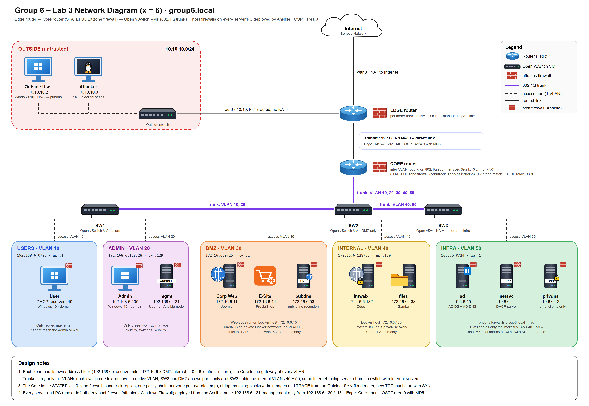

# SPR500 Lab 03 — Configure Network Segregation Policies

**Group 6** · `group6.local` · Building on the [Lab 02 zoned network](../lab02/README.md)

Lab 03 hardens the zoned network with a **stateful internal firewall** and **automated, default-deny host firewalls on every machine**.

## Deliverables

| Document | Status |
|---|---|
| [Migration plan (project plan)](migration-plan.md) | ✅ Added |
| Final report (deployment evidence, screenshots, test results) | To be added |
| TVRA (threat and vulnerability risk assessment) | To be added |

## What changes from Lab 02

| Area | Lab 02 | Lab 03 |
|---|---|---|
| Core firewall | Stateless nftables (a separate reply rule for every flow) | **Stateful nftables:** connection tracking, invalid packets dropped, NEW TCP flows must start with SYN |
| Rule structure | One long forward chain | **Verdict map** (in-interface · out-interface) jumping to one policy chain per zone pair; named sets for addresses and ports |
| Advanced filtering | None | **Layer-7 string matching** blocks `GET/POST /admin` and `TRACE` from outside; **per-source SYN-flood meter** |
| Host firewalls | Hand-written on some servers | **Default-deny on every server and PC**, generated and deployed by **Ansible** |
| Automation | Configs copied by hand | Ansible control node in the Admin VLAN; one playbook deploys router and host firewalls, syntax-checked with `nft -c` first; secrets in `ansible-vault` |

## Plan highlights

- **13 business requirements**, each with a test case and acceptance criteria. Examples: internal systems unreachable from the Internet (nmap shows all ports filtered), an ACK scan blocked by the stateful firewall, admin portals hidden from outside, and every denied packet logged.
- **Security zones, access policies and zone boundaries** documented per VLAN.
- **Firewall test cases** and a **step-by-step migration with rollback**.
- **Appendix:** the Ansible project layout (`router_fw`, `linux_hostfw`, `windows_hostfw` roles) and an excerpt of the Core's stateful ruleset.

**Skills:** nftables (stateful, verdict maps, L7 matching, rate-limit meters) · Ansible (roles, Jinja2 templates, vault, `--check --diff`) · Windows Firewall via WinRM · network segmentation · change management with rollback

---

*Group 6 work. Contributors: [@rabbiaman03](https://github.com/rabbiaman03), [@cybersaviour-AS](https://github.com/cybersaviour-AS).*
